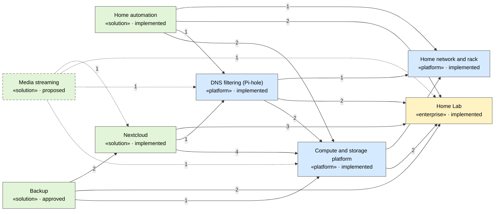

<!-- generated by a4m build; edit models/, not this file -->
# Home Lab

The home lab as an enterprise: why it exists (motivation), what it can do (capabilities), who uses it (business) and the roadmap. Every solution architecture under models/ builds on these elements; it is the test bed for the a4m workflow before the office network.

8 solution architectures · 61 elements · 99 relationships.
Each SA lives in `models/<sa>/`; this page and `docs/_landscape/` are generated from all of them.

- [System landscape](_landscape/system-landscape.md) — every system, grouped by SA (C4)
- [Deployment](_landscape/deployment.md) — where everything runs (C4)
- [Platform consumers](_landscape/consumers.md) — who uses what each SA exports
- Archi: import `build/_landscape.oef.xml` for the whole enterprise in one model

## Solution architectures

| SA | Kind | Status | Owner | Elements | Changes | Uses | Used by |
|---|---|---|---|---|---|---|---|
| [Backup](backup/README.md) (`backup`) | solution | approved | home lab admin | 4 | +2 new, −2 retiring | [compute](compute/README.md), [enterprise](enterprise/README.md), [nextcloud](nextcloud/README.md) | — |
| [Compute and storage platform](compute/README.md) (`compute`) | platform | implemented | home lab admin | 7 | — | [enterprise](enterprise/README.md), [network](network/README.md) | [backup](backup/README.md), [dns](dns/README.md), [home-automation](home-automation/README.md), [media](media/README.md), [nextcloud](nextcloud/README.md) |
| [DNS filtering (Pi-hole)](dns/README.md) (`dns`) | platform | implemented | home lab admin | 3 | — | [compute](compute/README.md), [enterprise](enterprise/README.md), [network](network/README.md) | [home-automation](home-automation/README.md), [media](media/README.md), [nextcloud](nextcloud/README.md) |
| [Home Lab](enterprise/README.md) (`enterprise`) | enterprise | implemented | home lab admin | 25 | — | — | [backup](backup/README.md), [compute](compute/README.md), [dns](dns/README.md), [home-automation](home-automation/README.md), [media](media/README.md), [nextcloud](nextcloud/README.md) |
| [Home automation](home-automation/README.md) (`home-automation`) | solution | implemented | home lab admin | 3 | — | [compute](compute/README.md), [dns](dns/README.md), [enterprise](enterprise/README.md), [network](network/README.md) | — |
| [Media streaming](media/README.md) (`media`) | solution | proposed | home lab admin | 3 | +9 new | [compute](compute/README.md), [dns](dns/README.md), [enterprise](enterprise/README.md), [nextcloud](nextcloud/README.md) | — |
| [Home network and rack](network/README.md) (`network`) | platform | implemented | home lab admin | 7 | — | — | [compute](compute/README.md), [dns](dns/README.md), [home-automation](home-automation/README.md) |
| [Nextcloud](nextcloud/README.md) (`nextcloud`) | solution | implemented | home lab admin | 9 | — | [compute](compute/README.md), [dns](dns/README.md), [enterprise](enterprise/README.md) | [backup](backup/README.md), [media](media/README.md) |

Changes in an SA reach the landscape's target state once the SA is **approved** (or implemented).

## Dependencies between SAs

An arrow means the SA at the tail references elements of the SA at the head (number = relationships; dashed = all new).

