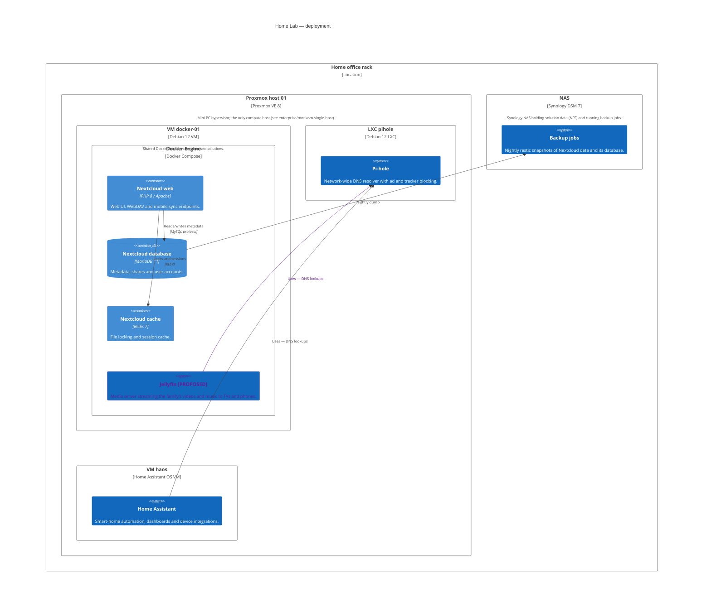
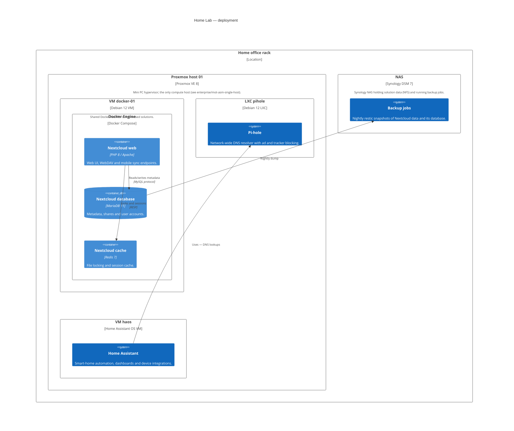

<!-- generated by a4m build; edit models/, not this file -->
# Home Lab — deployment

*C4 deployment view* · [index](../README.md)

Where every container and system runs, across all SAs.

*Change highlighting: green = new, orange = changed, red = retiring (purple = proposed by an SA that is not approved yet).*

Current state

Target state

## Elements

| Element | Type | Layer | C4 | State | Description |
|---|---|---|---|---|---|
| Backup jobs (`backup/app-backup`) | ApplicationComponent | Application | system |  | Nightly restic snapshots of Nextcloud data and its database. |
| Pi-hole (`dns/app-pihole`) | ApplicationComponent | Application | system |  | Network-wide DNS resolver with ad and tracker blocking. |
| Home Assistant (`home-automation/app-home-assistant`) | ApplicationComponent | Application | system |  | Smart-home automation, dashboards and device integrations. |
| Jellyfin (`media/app-jellyfin`) | ApplicationComponent | Application | system | new | Media server streaming the family's videos and music to TVs and phones. |
| Nextcloud web (`nextcloud/app-nextcloud-web`) | ApplicationComponent | Application | container |  | Web UI, WebDAV and mobile sync endpoints. |
| Nextcloud database (`nextcloud/app-nextcloud-db`) | ApplicationComponent | Application | container |  | Metadata, shares and user accounts. |
| Nextcloud cache (`nextcloud/app-nextcloud-cache`) | ApplicationComponent | Application | container |  | File locking and session cache. |
| Home office rack (`network/oth-loc-home`) | Location | Other | deployment |  |  |
| Proxmox host 01 (`compute/tech-pve-01`) | Node | Technology | deployment |  | Mini PC hypervisor; the only compute host (see enterprise/mot-asm-single-host). |
| VM docker-01 (`compute/tech-vm-docker`) | Node | Technology | deployment |  | Shared Docker host for containerised solutions. |
| Docker Engine (`compute/tech-docker`) | SystemSoftware | Technology | deployment |  |  |
| LXC pihole (`dns/tech-lxc-pihole`) | Node | Technology | deployment |  |  |
| VM haos (`home-automation/tech-vm-haos`) | Node | Technology | deployment |  |  |
| NAS (`compute/tech-nas`) | Device | Technology | deployment |  | Synology NAS holding solution data (NFS) and running backup jobs. |

## Related decisions

- [ADR-0001: Move off-site backups from Backblaze B2 to a Hetzner Storage Box](../../models/backup/decisions/ADR-0001-move-offsite-backups-to-hetzner.md) — *accepted*
- [ADR-0001: Use Proxmox VE for virtualisation](../../models/compute/decisions/ADR-0001-use-proxmox-for-virtualisation.md) — *accepted*
- [ADR-0001: Add Jellyfin as the family media server](../../models/media/decisions/ADR-0001-add-jellyfin-media-server.md) — *proposed*
- [ADR-0001: Run Nextcloud as Docker containers on a dedicated VM](../../models/nextcloud/decisions/ADR-0001-run-nextcloud-as-containers.md) — *accepted*
