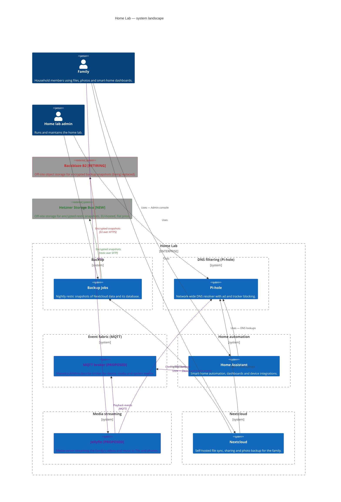
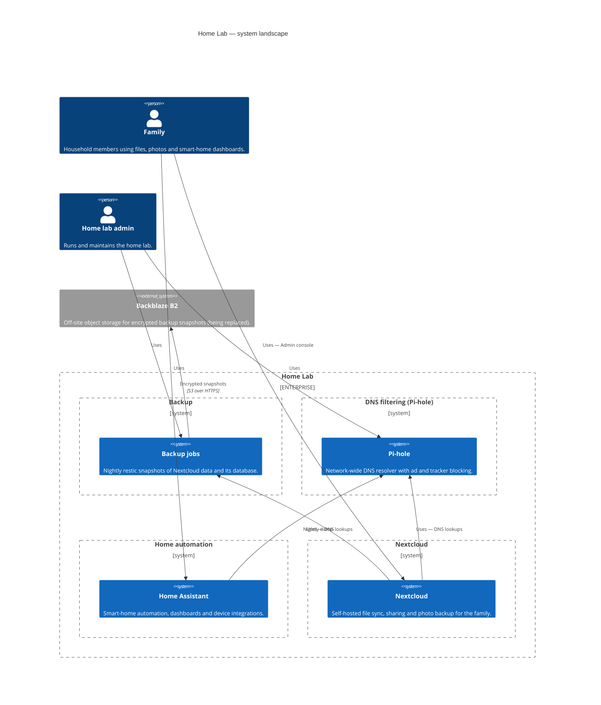
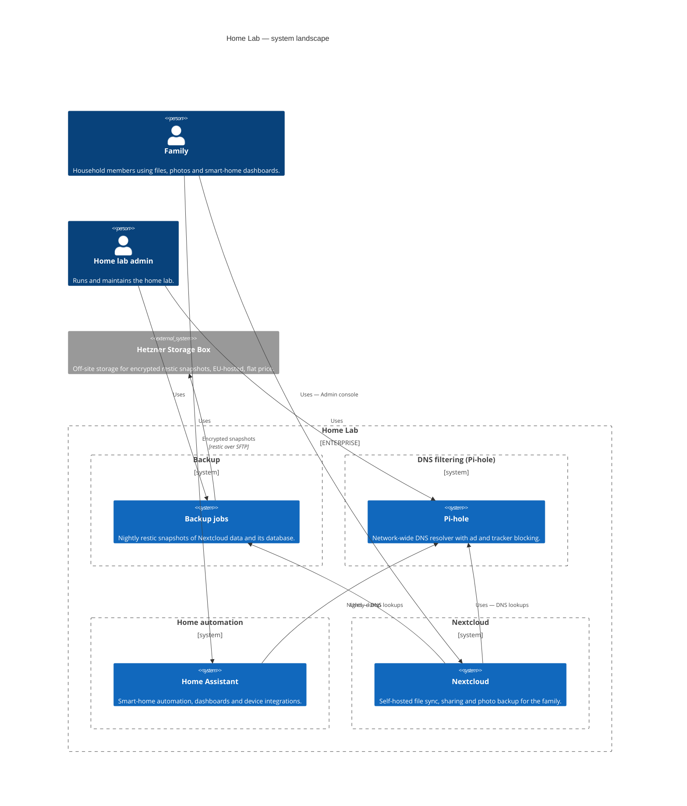

<!-- generated by a4m build; edit models/, not this file -->
# Home Lab — system landscape

*C4 context view* · [index](../README.md)

Every system of every solution architecture, grouped by SA, with the people who use them. Generated from the c4 tags and relationships of all SAs.

*Change highlighting: green = new, orange = changed, red = retiring (purple = proposed by an SA that is not approved yet).*

Current state

Target state

## Elements

| Element | Type | Layer | C4 | State | Description |
|---|---|---|---|---|---|
| Family (`enterprise/bus-family`) | BusinessActor | Business | person |  | Household members using files, photos and smart-home dashboards. |
| Home lab admin (`enterprise/bus-admin`) | BusinessActor | Business | person |  | Runs and maintains the home lab. |
| Backup jobs (`backup/app-backup`) | ApplicationComponent | Application | system |  | Nightly restic snapshots of Nextcloud data and its database. |
| Backblaze B2 (`backup/app-offsite-b2`) | ApplicationComponent | Application | system | retiring | Off-site object storage for encrypted backup snapshots (being replaced). |
| Hetzner Storage Box (`backup/app-offsite-hetzner`) | ApplicationComponent | Application | system | new | Off-site storage for encrypted restic snapshots, EU-hosted, flat price. |
| Pi-hole (`dns/app-pihole`) | ApplicationComponent | Application | system |  | Network-wide DNS resolver with ad and tracker blocking. |
| MQTT broker (`events/app-mqtt-broker`) | ApplicationComponent | Application | system | new | Shared publish/subscribe broker for device, media and system events. |
| Home Assistant (`home-automation/app-home-assistant`) | ApplicationComponent | Application | system |  | Smart-home automation, dashboards and device integrations. |
| Jellyfin (`media/app-jellyfin`) | ApplicationComponent | Application | system | new | Media server streaming the family's videos and music to TVs and phones. |
| Nextcloud (`nextcloud/app-nextcloud`) | ApplicationComponent | Application | system |  | Self-hosted file sync, sharing and photo backup for the family. |

## Related decisions

- [ADR-0001: Move off-site backups from Backblaze B2 to a Hetzner Storage Box](../../models/backup/decisions/ADR-0001-move-offsite-backups-to-hetzner.md) — *accepted*
- [ADR-0001: Introduce a shared MQTT event fabric](../../models/events/decisions/ADR-0001-introduce-a-shared-mqtt-event-fabric.md) — *proposed*
- [ADR-0001: Add Jellyfin as the family media server](../../models/media/decisions/ADR-0001-add-jellyfin-media-server.md) — *proposed*
- [ADR-0001: Run Nextcloud as Docker containers on a dedicated VM](../../models/nextcloud/decisions/ADR-0001-run-nextcloud-as-containers.md) — *accepted*
