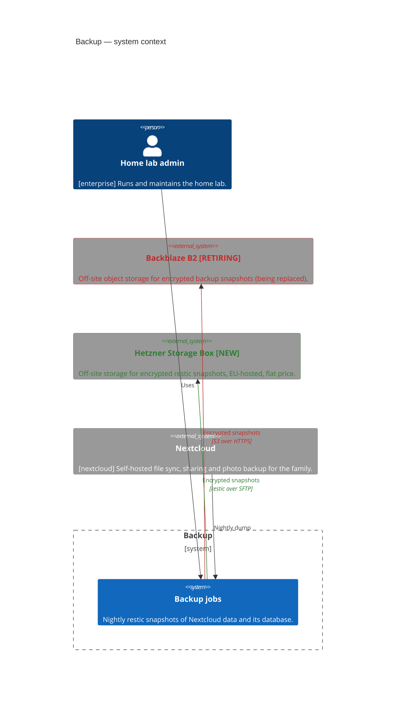
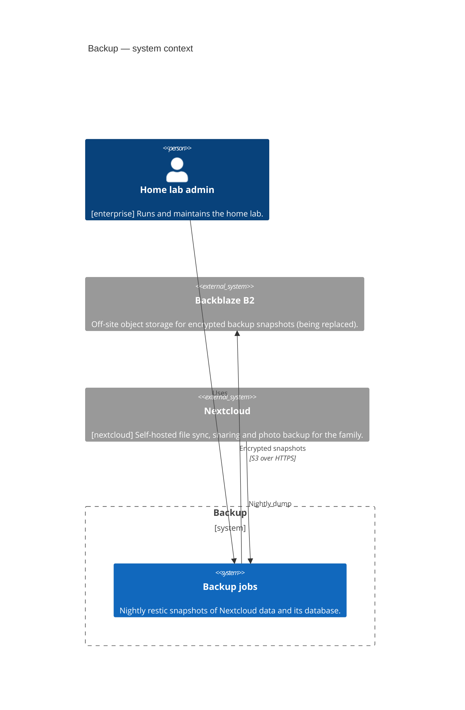
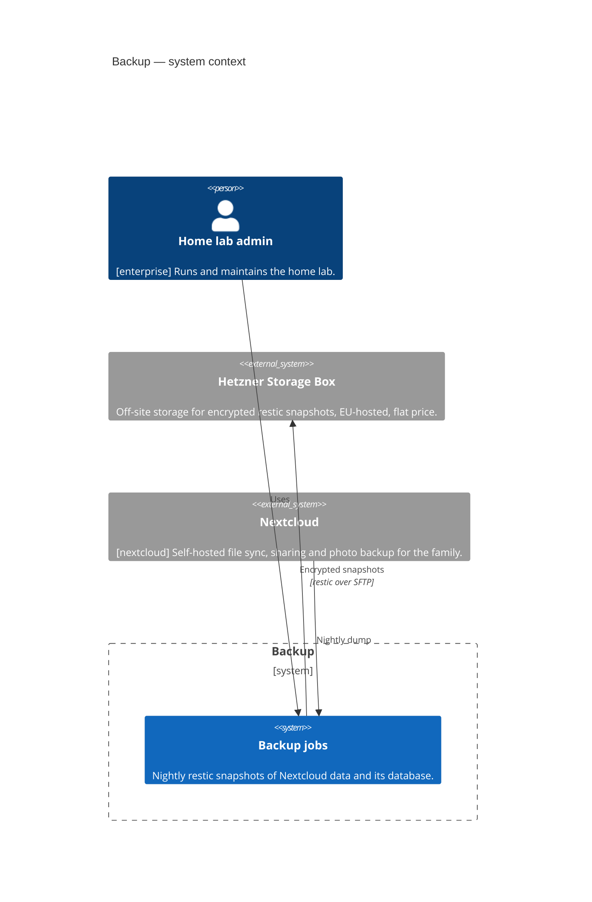

<!-- generated by a4m build; edit models/, not this file -->
# Backup — system context

*C4 context view* · source `models/backup/views/views.yaml` · [index](README.md)

*Change highlighting: green = new, orange = changed, red = retiring (purple = proposed by an SA that is not approved yet).*

Current state

Target state

## Elements

| Element | Type | Layer | C4 | State | Description |
|---|---|---|---|---|---|
| Home lab admin (`enterprise/bus-admin`) | BusinessActor | Business | person |  | Runs and maintains the home lab. |
| Backup jobs (`app-backup`) | ApplicationComponent | Application | system |  | Nightly restic snapshots of Nextcloud data and its database. |
| Backblaze B2 (`app-offsite-b2`) | ApplicationComponent | Application | system | retiring | Off-site object storage for encrypted backup snapshots (being replaced). |
| Hetzner Storage Box (`app-offsite-hetzner`) | ApplicationComponent | Application | system | new | Off-site storage for encrypted restic snapshots, EU-hosted, flat price. |
| Nextcloud (`nextcloud/app-nextcloud`) | ApplicationComponent | Application | system |  | Self-hosted file sync, sharing and photo backup for the family. |

## Related decisions

- [ADR-0001: Move off-site backups from Backblaze B2 to a Hetzner Storage Box](../../models/backup/decisions/ADR-0001-move-offsite-backups-to-hetzner.md) — *accepted*
