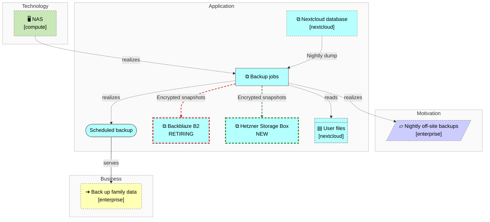
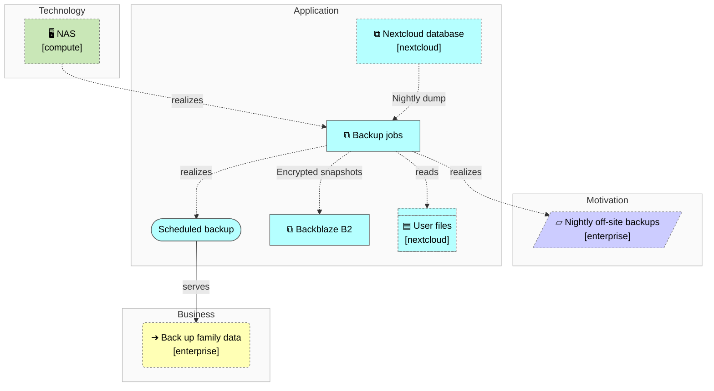
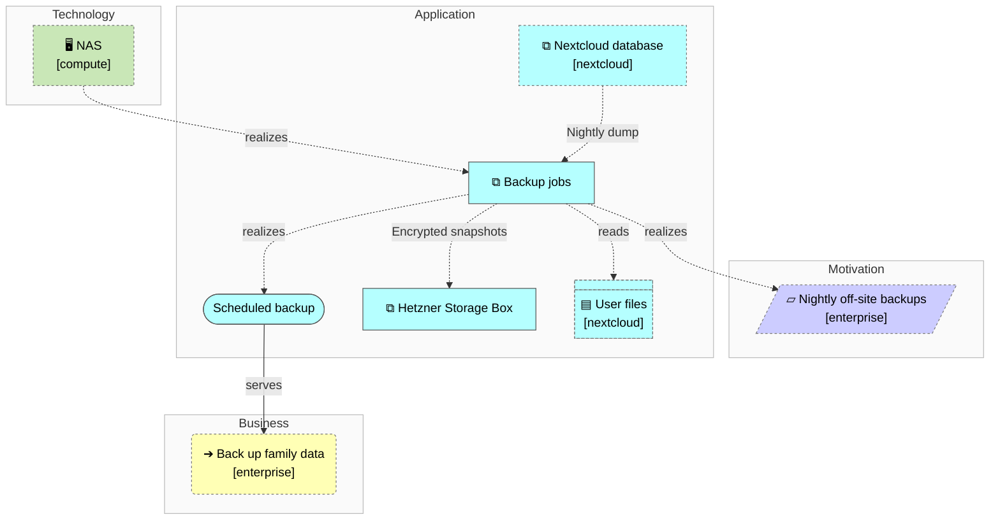

<!-- generated by a4m build; edit models/, not this file -->
# Backup — overview

*ArchiMate view* · source `models/backup/views/views.yaml` · [index](README.md)

What is backed up, from where, and where the copies go (current → target).

*Notation: ▱ Requirement · ➔ Business process · ⧉ Application component · (pill) Application service · ▤ Data object · 🖥 Device*

*Change highlighting: green = new, orange = changed, red = retiring (purple = proposed by an SA that is not approved yet).*

Current state

Target state

## Elements

| Element | Type | Layer | C4 | State | Description |
|---|---|---|---|---|---|
| Backup jobs (`app-backup`) | ApplicationComponent | Application | system |  | Nightly restic snapshots of Nextcloud data and its database. |
| Scheduled backup (`app-svc-backup`) | ApplicationService | Application |  |  |  |
| Backblaze B2 (`app-offsite-b2`) | ApplicationComponent | Application | system | retiring | Off-site object storage for encrypted backup snapshots (being replaced). |
| Hetzner Storage Box (`app-offsite-hetzner`) | ApplicationComponent | Application | system | new | Off-site storage for encrypted restic snapshots, EU-hosted, flat price. |
| NAS (`compute/tech-nas`) | Device | Technology | deployment |  | Synology NAS holding solution data (NFS) and running backup jobs. |
| Back up family data (`enterprise/bus-proc-backup`) | BusinessProcess | Business |  |  |  |
| Nightly off-site backups (`enterprise/mot-req-backup`) | Requirement | Motivation |  |  |  |
| User files (`nextcloud/app-data-files`) | DataObject | Application |  |  | Family files and photos, stored on the NAS over NFS. |
| Nextcloud database (`nextcloud/app-nextcloud-db`) | ApplicationComponent | Application | container |  | Metadata, shares and user accounts. |

## Related decisions

- [ADR-0001: Move off-site backups from Backblaze B2 to a Hetzner Storage Box](../../models/backup/decisions/ADR-0001-move-offsite-backups-to-hetzner.md) — *accepted*
