<!-- generated by a4m build; edit models/, not this file -->
# Compute and storage

*ArchiMate view* · source `models/compute/views/views.yaml` · [index](README.md)

The hypervisor, Docker VM and NAS, with the workloads other SAs run on them.

```mermaid
flowchart TB
  subgraph layer_infrastructure["Infrastructure"]
    direction LR
    infra_pve_01["Proxmox host 01<br/>«Node»"]
    infra_proxmox_ve["Proxmox VE<br/>«SystemSoftware»"]
    infra_vm_docker["VM docker-01<br/>«Node»"]
    infra_docker["Docker Engine<br/>«SystemSoftware»"]
    infra_nas["NAS<br/>«Device»"]
    infra_svc_vm_hosting("VM hosting<br/>«TechnologyService»")
    infra_svc_nfs("NFS storage<br/>«TechnologyService»")
    dns__infra_lxc_pihole["LXC pihole<br/>«Node» · dns"]
    home_automation__infra_vm_haos["VM haos<br/>«Node» · home-automation"]
    media__infra_art_jellyfin[/"jellyfin/jellyfin image<br/>«Artifact» · media<br/>NEW"/]
    network__infra_loc_home[["Home office rack<br/>«Location» · network"]]
    network__infra_net_lan["LAN (VLAN 10)<br/>«CommunicationNetwork» · network"]
    network__infra_ups["UPS<br/>«Equipment» · network"]
    nextcloud__infra_art_mariadb[/"mariadb:11 image<br/>«Artifact» · nextcloud"/]
    nextcloud__infra_art_nextcloud[/"nextcloud:29-apache image<br/>«Artifact» · nextcloud"/]
    nextcloud__infra_art_redis[/"redis:7 image<br/>«Artifact» · nextcloud"/]
  end
  infra_pve_01 -->|"composed of"| infra_proxmox_ve
  infra_pve_01 -->|"composed of"| infra_vm_docker
  infra_proxmox_ve -.->|"realizes"| infra_svc_vm_hosting
  infra_svc_vm_hosting -->|"serves"| infra_vm_docker
  infra_vm_docker -->|"assigned to"| infra_docker
  infra_nas -.->|"realizes"| infra_svc_nfs
  infra_svc_nfs -->|"Docker data volumes"| infra_vm_docker
  network__infra_loc_home -->|"aggregates"| infra_pve_01
  network__infra_loc_home -->|"aggregates"| infra_nas
  network__infra_ups -->|"serves"| infra_pve_01
  network__infra_ups -->|"serves"| infra_nas
  infra_pve_01 ---|"associated with"| network__infra_net_lan
  infra_nas ---|"associated with"| network__infra_net_lan
  infra_pve_01 -->|"composed of"| dns__infra_lxc_pihole
  infra_svc_vm_hosting -->|"serves"| dns__infra_lxc_pihole
  dns__infra_lxc_pihole ---|"associated with"| network__infra_net_lan
  infra_pve_01 -->|"composed of"| home_automation__infra_vm_haos
  infra_svc_vm_hosting -->|"serves"| home_automation__infra_vm_haos
  infra_docker -->|"assigned to"| media__infra_art_jellyfin
  network__infra_loc_home -->|"aggregates"| network__infra_ups
  infra_docker -->|"assigned to"| nextcloud__infra_art_nextcloud
  infra_docker -->|"assigned to"| nextcloud__infra_art_mariadb
  infra_docker -->|"assigned to"| nextcloud__infra_art_redis
  classDef infrastructure fill:#C9E7B7,stroke:#555,color:#000
  class infra_pve_01,infra_proxmox_ve,infra_vm_docker,infra_docker,infra_nas,infra_svc_vm_hosting,infra_svc_nfs,dns__infra_lxc_pihole,home_automation__infra_vm_haos,media__infra_art_jellyfin,network__infra_loc_home,network__infra_net_lan,network__infra_ups,nextcloud__infra_art_mariadb,nextcloud__infra_art_nextcloud,nextcloud__infra_art_redis infrastructure
  style layer_infrastructure fill:#fafafa,stroke:#bbb
  classDef foreign stroke:#777,stroke-dasharray:3 3
  class dns__infra_lxc_pihole,home_automation__infra_vm_haos,media__infra_art_jellyfin,network__infra_loc_home,network__infra_net_lan,network__infra_ups,nextcloud__infra_art_mariadb,nextcloud__infra_art_nextcloud,nextcloud__infra_art_redis foreign
  classDef st_new stroke:#2e7d32,stroke-width:3px,stroke-dasharray:6 4
  class media__infra_art_jellyfin st_new
  linkStyle 18 stroke:#2e7d32,stroke-width:2px,stroke-dasharray:6 4
```

*Change highlighting: green = new, orange = changed, red = retiring (purple = proposed by an SA that is not approved yet).*

```mermaid
flowchart TB
  subgraph layer_infrastructure["Infrastructure"]
    direction LR
    infra_pve_01["Proxmox host 01<br/>«Node»"]
    infra_proxmox_ve["Proxmox VE<br/>«SystemSoftware»"]
    infra_vm_docker["VM docker-01<br/>«Node»"]
    infra_docker["Docker Engine<br/>«SystemSoftware»"]
    infra_nas["NAS<br/>«Device»"]
    infra_svc_vm_hosting("VM hosting<br/>«TechnologyService»")
    infra_svc_nfs("NFS storage<br/>«TechnologyService»")
    dns__infra_lxc_pihole["LXC pihole<br/>«Node» · dns"]
    home_automation__infra_vm_haos["VM haos<br/>«Node» · home-automation"]
    network__infra_loc_home[["Home office rack<br/>«Location» · network"]]
    network__infra_net_lan["LAN (VLAN 10)<br/>«CommunicationNetwork» · network"]
    network__infra_ups["UPS<br/>«Equipment» · network"]
    nextcloud__infra_art_mariadb[/"mariadb:11 image<br/>«Artifact» · nextcloud"/]
    nextcloud__infra_art_nextcloud[/"nextcloud:29-apache image<br/>«Artifact» · nextcloud"/]
    nextcloud__infra_art_redis[/"redis:7 image<br/>«Artifact» · nextcloud"/]
  end
  infra_pve_01 -->|"composed of"| infra_proxmox_ve
  infra_pve_01 -->|"composed of"| infra_vm_docker
  infra_proxmox_ve -.->|"realizes"| infra_svc_vm_hosting
  infra_svc_vm_hosting -->|"serves"| infra_vm_docker
  infra_vm_docker -->|"assigned to"| infra_docker
  infra_nas -.->|"realizes"| infra_svc_nfs
  infra_svc_nfs -->|"Docker data volumes"| infra_vm_docker
  network__infra_loc_home -->|"aggregates"| infra_pve_01
  network__infra_loc_home -->|"aggregates"| infra_nas
  network__infra_ups -->|"serves"| infra_pve_01
  network__infra_ups -->|"serves"| infra_nas
  infra_pve_01 ---|"associated with"| network__infra_net_lan
  infra_nas ---|"associated with"| network__infra_net_lan
  infra_pve_01 -->|"composed of"| dns__infra_lxc_pihole
  infra_svc_vm_hosting -->|"serves"| dns__infra_lxc_pihole
  dns__infra_lxc_pihole ---|"associated with"| network__infra_net_lan
  infra_pve_01 -->|"composed of"| home_automation__infra_vm_haos
  infra_svc_vm_hosting -->|"serves"| home_automation__infra_vm_haos
  network__infra_loc_home -->|"aggregates"| network__infra_ups
  infra_docker -->|"assigned to"| nextcloud__infra_art_nextcloud
  infra_docker -->|"assigned to"| nextcloud__infra_art_mariadb
  infra_docker -->|"assigned to"| nextcloud__infra_art_redis
  classDef infrastructure fill:#C9E7B7,stroke:#555,color:#000
  class infra_pve_01,infra_proxmox_ve,infra_vm_docker,infra_docker,infra_nas,infra_svc_vm_hosting,infra_svc_nfs,dns__infra_lxc_pihole,home_automation__infra_vm_haos,network__infra_loc_home,network__infra_net_lan,network__infra_ups,nextcloud__infra_art_mariadb,nextcloud__infra_art_nextcloud,nextcloud__infra_art_redis infrastructure
  style layer_infrastructure fill:#fafafa,stroke:#bbb
  classDef foreign stroke:#777,stroke-dasharray:3 3
  class dns__infra_lxc_pihole,home_automation__infra_vm_haos,network__infra_loc_home,network__infra_net_lan,network__infra_ups,nextcloud__infra_art_mariadb,nextcloud__infra_art_nextcloud,nextcloud__infra_art_redis foreign
```

Current state

Target state

```mermaid
flowchart TB
  subgraph layer_infrastructure["Infrastructure"]
    direction LR
    infra_pve_01["Proxmox host 01<br/>«Node»"]
    infra_proxmox_ve["Proxmox VE<br/>«SystemSoftware»"]
    infra_vm_docker["VM docker-01<br/>«Node»"]
    infra_docker["Docker Engine<br/>«SystemSoftware»"]
    infra_nas["NAS<br/>«Device»"]
    infra_svc_vm_hosting("VM hosting<br/>«TechnologyService»")
    infra_svc_nfs("NFS storage<br/>«TechnologyService»")
    dns__infra_lxc_pihole["LXC pihole<br/>«Node» · dns"]
    home_automation__infra_vm_haos["VM haos<br/>«Node» · home-automation"]
    media__infra_art_jellyfin[/"jellyfin/jellyfin image<br/>«Artifact» · media"/]
    network__infra_loc_home[["Home office rack<br/>«Location» · network"]]
    network__infra_net_lan["LAN (VLAN 10)<br/>«CommunicationNetwork» · network"]
    network__infra_ups["UPS<br/>«Equipment» · network"]
    nextcloud__infra_art_mariadb[/"mariadb:11 image<br/>«Artifact» · nextcloud"/]
    nextcloud__infra_art_nextcloud[/"nextcloud:29-apache image<br/>«Artifact» · nextcloud"/]
    nextcloud__infra_art_redis[/"redis:7 image<br/>«Artifact» · nextcloud"/]
  end
  infra_pve_01 -->|"composed of"| infra_proxmox_ve
  infra_pve_01 -->|"composed of"| infra_vm_docker
  infra_proxmox_ve -.->|"realizes"| infra_svc_vm_hosting
  infra_svc_vm_hosting -->|"serves"| infra_vm_docker
  infra_vm_docker -->|"assigned to"| infra_docker
  infra_nas -.->|"realizes"| infra_svc_nfs
  infra_svc_nfs -->|"Docker data volumes"| infra_vm_docker
  network__infra_loc_home -->|"aggregates"| infra_pve_01
  network__infra_loc_home -->|"aggregates"| infra_nas
  network__infra_ups -->|"serves"| infra_pve_01
  network__infra_ups -->|"serves"| infra_nas
  infra_pve_01 ---|"associated with"| network__infra_net_lan
  infra_nas ---|"associated with"| network__infra_net_lan
  infra_pve_01 -->|"composed of"| dns__infra_lxc_pihole
  infra_svc_vm_hosting -->|"serves"| dns__infra_lxc_pihole
  dns__infra_lxc_pihole ---|"associated with"| network__infra_net_lan
  infra_pve_01 -->|"composed of"| home_automation__infra_vm_haos
  infra_svc_vm_hosting -->|"serves"| home_automation__infra_vm_haos
  infra_docker -->|"assigned to"| media__infra_art_jellyfin
  network__infra_loc_home -->|"aggregates"| network__infra_ups
  infra_docker -->|"assigned to"| nextcloud__infra_art_nextcloud
  infra_docker -->|"assigned to"| nextcloud__infra_art_mariadb
  infra_docker -->|"assigned to"| nextcloud__infra_art_redis
  classDef infrastructure fill:#C9E7B7,stroke:#555,color:#000
  class infra_pve_01,infra_proxmox_ve,infra_vm_docker,infra_docker,infra_nas,infra_svc_vm_hosting,infra_svc_nfs,dns__infra_lxc_pihole,home_automation__infra_vm_haos,media__infra_art_jellyfin,network__infra_loc_home,network__infra_net_lan,network__infra_ups,nextcloud__infra_art_mariadb,nextcloud__infra_art_nextcloud,nextcloud__infra_art_redis infrastructure
  style layer_infrastructure fill:#fafafa,stroke:#bbb
  classDef foreign stroke:#777,stroke-dasharray:3 3
  class dns__infra_lxc_pihole,home_automation__infra_vm_haos,media__infra_art_jellyfin,network__infra_loc_home,network__infra_net_lan,network__infra_ups,nextcloud__infra_art_mariadb,nextcloud__infra_art_nextcloud,nextcloud__infra_art_redis foreign
```

## Elements

| Element | Type | Layer | C4 | State | Description |
|---|---|---|---|---|---|
| Proxmox host 01 (`infra-pve-01`) | Node | Infrastructure | deployment |  | Mini PC hypervisor; the only compute host (see enterprise/bus-asm-single-host). |
| Proxmox VE (`infra-proxmox-ve`) | SystemSoftware | Infrastructure |  |  |  |
| VM docker-01 (`infra-vm-docker`) | Node | Infrastructure | deployment |  | Shared Docker host for containerised solutions. |
| Docker Engine (`infra-docker`) | SystemSoftware | Infrastructure | deployment |  |  |
| NAS (`infra-nas`) | Device | Infrastructure | deployment |  | Synology NAS holding solution data (NFS) and running backup jobs. |
| VM hosting (`infra-svc-vm-hosting`) | TechnologyService | Infrastructure |  |  |  |
| NFS storage (`infra-svc-nfs`) | TechnologyService | Infrastructure |  |  |  |
| LXC pihole (`dns/infra-lxc-pihole`) | Node | Infrastructure | deployment |  |  |
| VM haos (`home-automation/infra-vm-haos`) | Node | Infrastructure | deployment |  |  |
| jellyfin/jellyfin image (`media/infra-art-jellyfin`) | Artifact | Infrastructure |  | new |  |
| Home office rack (`network/infra-loc-home`) | Location | Infrastructure | deployment |  |  |
| LAN (VLAN 10) (`network/infra-net-lan`) | CommunicationNetwork | Infrastructure |  |  |  |
| UPS (`network/infra-ups`) | Equipment | Infrastructure |  |  | 900 VA line-interactive UPS; ~20 minutes runtime for host, NAS and network. |
| mariadb:11 image (`nextcloud/infra-art-mariadb`) | Artifact | Infrastructure |  |  |  |
| nextcloud:29-apache image (`nextcloud/infra-art-nextcloud`) | Artifact | Infrastructure |  |  |  |
| redis:7 image (`nextcloud/infra-art-redis`) | Artifact | Infrastructure |  |  |  |

## Related decisions

- [ADR-0001: Use Proxmox VE for virtualisation](../../models/compute/decisions/ADR-0001-use-proxmox-for-virtualisation.md) — *accepted*
