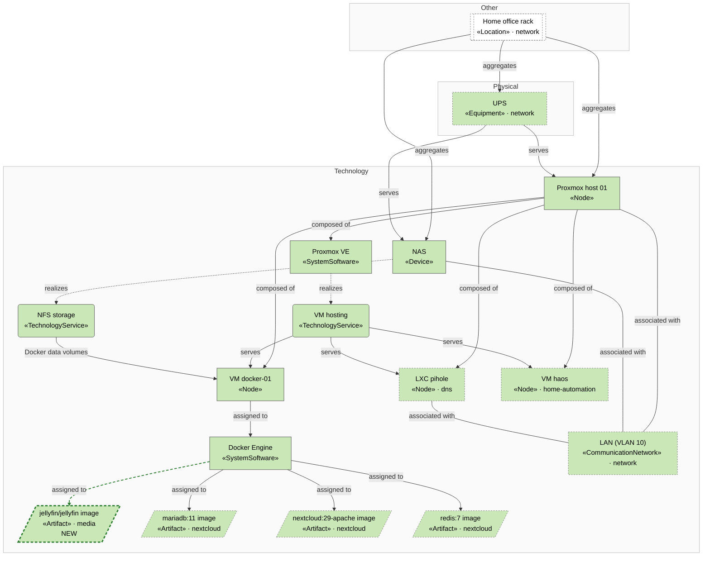
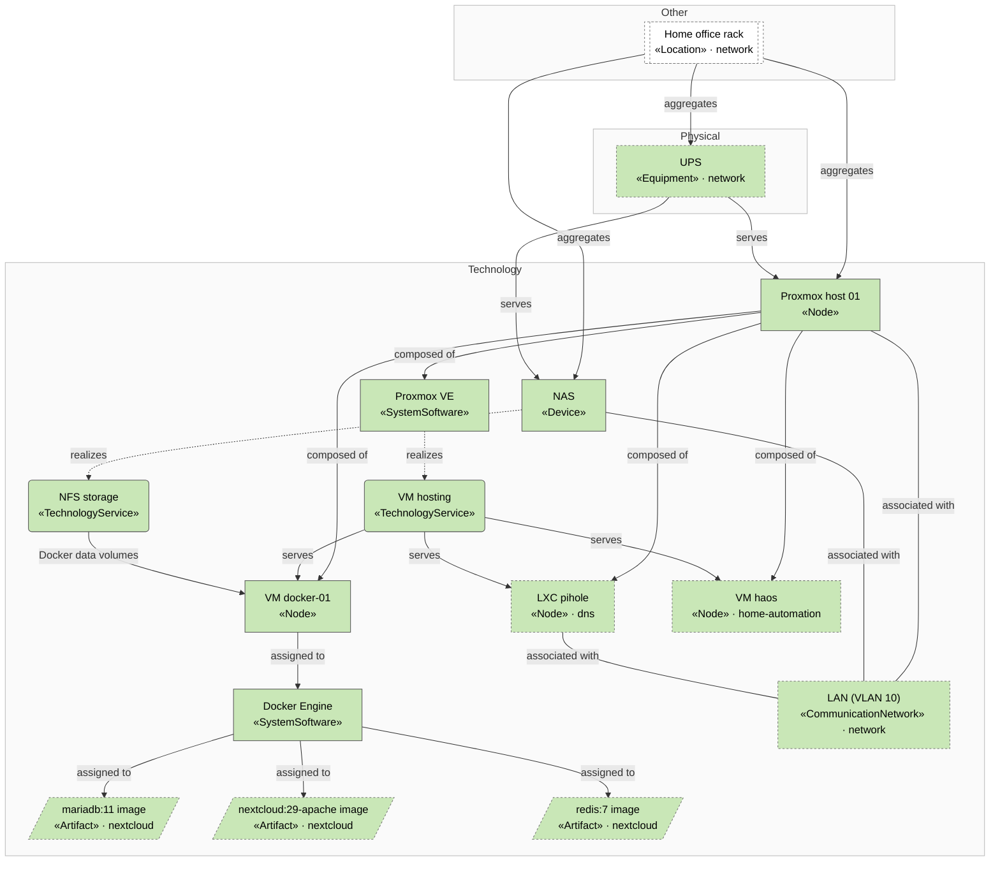
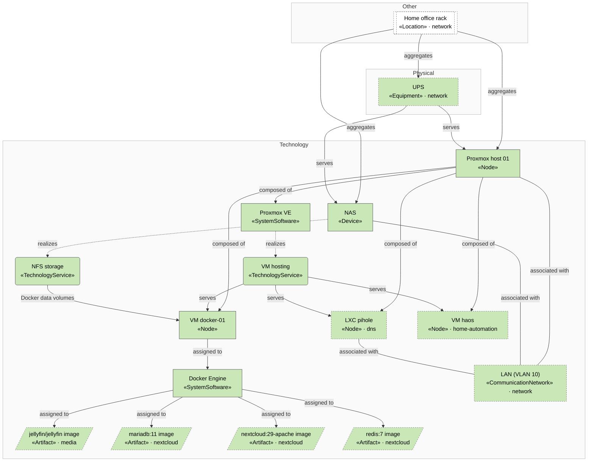

<!-- generated by a4m build; edit models/, not this file -->
# Compute and storage

*ArchiMate view* · source `models/compute/views/views.yaml` · [index](README.md)

The hypervisor, Docker VM and NAS, with the workloads other SAs run on them.

*Change highlighting: green = new, orange = changed, red = retiring (purple = proposed by an SA that is not approved yet).*

Current state

Target state

## Elements

| Element | Type | Layer | C4 | State | Description |
|---|---|---|---|---|---|
| Proxmox host 01 (`tech-pve-01`) | Node | Technology | deployment |  | Mini PC hypervisor; the only compute host (see enterprise/mot-asm-single-host). |
| Proxmox VE (`tech-proxmox-ve`) | SystemSoftware | Technology |  |  |  |
| VM docker-01 (`tech-vm-docker`) | Node | Technology | deployment |  | Shared Docker host for containerised solutions. |
| Docker Engine (`tech-docker`) | SystemSoftware | Technology | deployment |  |  |
| NAS (`tech-nas`) | Device | Technology | deployment |  | Synology NAS holding solution data (NFS) and running backup jobs. |
| VM hosting (`tech-svc-vm-hosting`) | TechnologyService | Technology |  |  |  |
| NFS storage (`tech-svc-nfs`) | TechnologyService | Technology |  |  |  |
| LXC pihole (`dns/tech-lxc-pihole`) | Node | Technology | deployment |  |  |
| VM haos (`home-automation/tech-vm-haos`) | Node | Technology | deployment |  |  |
| jellyfin/jellyfin image (`media/tech-art-jellyfin`) | Artifact | Technology |  | new |  |
| Home office rack (`network/oth-loc-home`) | Location | Other | deployment |  |  |
| UPS (`network/phys-ups`) | Equipment | Physical |  |  | 900 VA line-interactive UPS; ~20 minutes runtime for host, NAS and network. |
| LAN (VLAN 10) (`network/tech-net-lan`) | CommunicationNetwork | Technology |  |  |  |
| mariadb:11 image (`nextcloud/tech-art-mariadb`) | Artifact | Technology |  |  |  |
| nextcloud:29-apache image (`nextcloud/tech-art-nextcloud`) | Artifact | Technology |  |  |  |
| redis:7 image (`nextcloud/tech-art-redis`) | Artifact | Technology |  |  |  |

## Related decisions

- [ADR-0001: Use Proxmox VE for virtualisation](../../models/compute/decisions/ADR-0001-use-proxmox-for-virtualisation.md) — *accepted*
