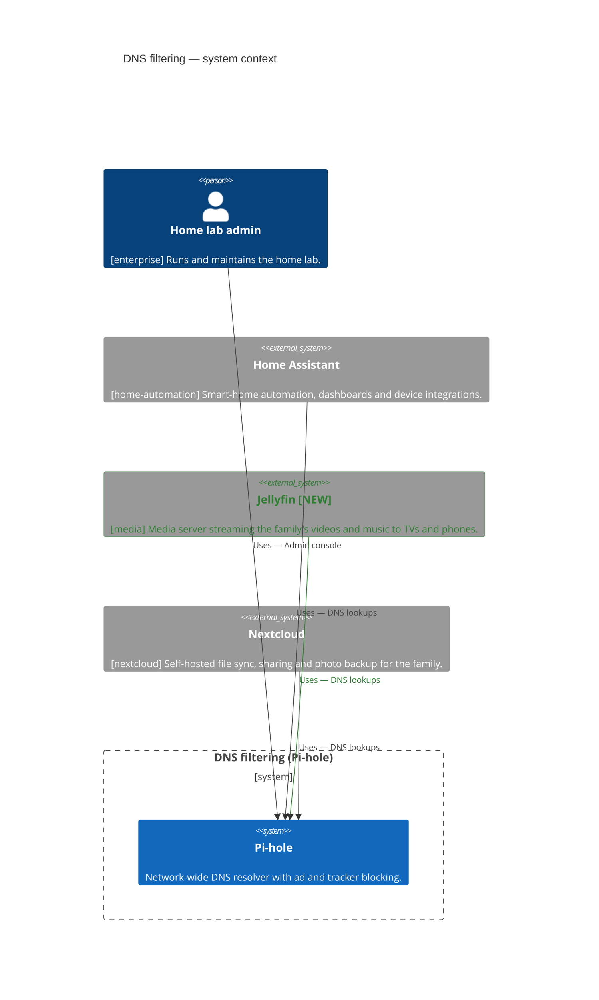
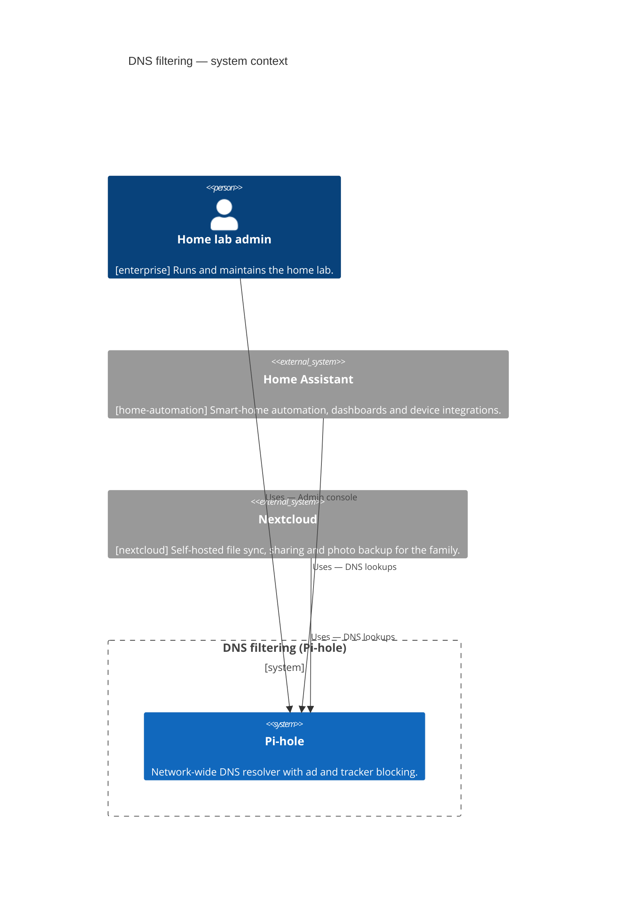

<!-- generated by a4m build; edit models/, not this file -->
# DNS filtering — system context

*C4 context view* · source `models/dns/views/views.yaml` · [index](README.md)

*Change highlighting: green = new, orange = changed, red = retiring (purple = proposed by an SA that is not approved yet).*

Current state

Target state

## Elements

| Element | Type | Layer | C4 | State | Description |
|---|---|---|---|---|---|
| Home lab admin (`enterprise/bus-admin`) | BusinessActor | Business | person |  | Runs and maintains the home lab. |
| Pi-hole (`app-pihole`) | ApplicationComponent | Application | system |  | Network-wide DNS resolver with ad and tracker blocking. |
| Home Assistant (`home-automation/app-home-assistant`) | ApplicationComponent | Application | system |  | Smart-home automation, dashboards and device integrations. |
| Jellyfin (`media/app-jellyfin`) | ApplicationComponent | Application | system | new | Media server streaming the family's videos and music to TVs and phones. |
| Nextcloud (`nextcloud/app-nextcloud`) | ApplicationComponent | Application | system |  | Self-hosted file sync, sharing and photo backup for the family. |
