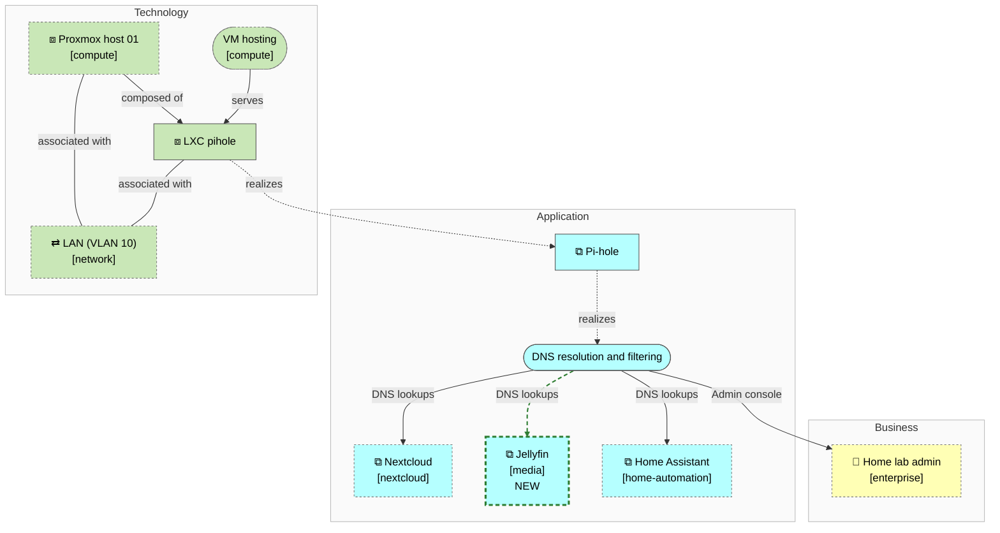
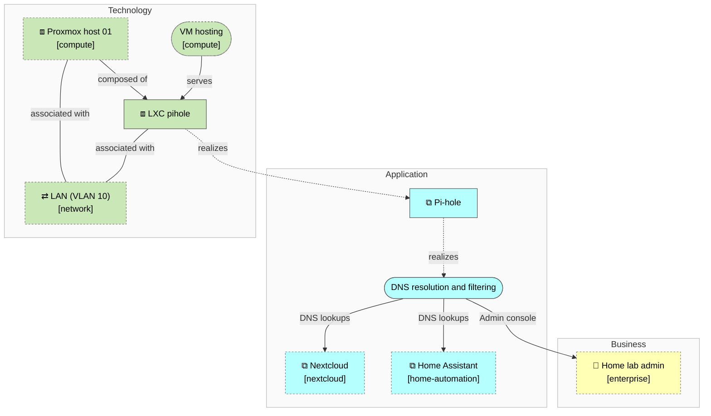
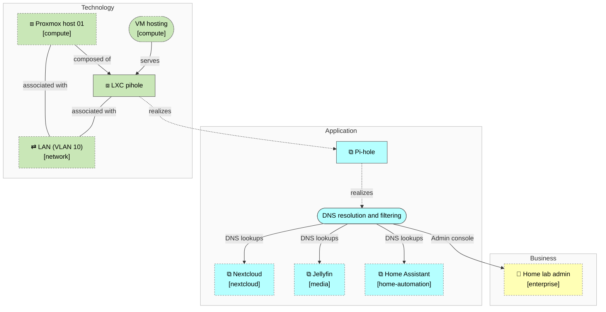

<!-- generated by a4m build; edit models/, not this file -->
# DNS filtering — overview

*ArchiMate view* · source `models/dns/views/views.yaml` · [index](README.md)

Pi-hole, the DNS service it offers, who uses it, and where it runs.

*Notation: 👤 Business actor · ⧉ Application component · (pill) Application service · ⇄ Communication network · ⧈ Node · (pill) Technology service*

*Change highlighting: green = new, orange = changed, red = retiring (purple = proposed by an SA that is not approved yet).*

Current state

Target state

## Elements

| Element | Type | Layer | C4 | State | Description |
|---|---|---|---|---|---|
| Pi-hole (`app-pihole`) | ApplicationComponent | Application | system |  | Network-wide DNS resolver with ad and tracker blocking. |
| DNS resolution and filtering (`app-svc-dns`) | ApplicationService | Application |  |  |  |
| LXC pihole (`tech-lxc-pihole`) | Node | Technology | deployment |  |  |
| Proxmox host 01 (`compute/tech-pve-01`) | Node | Technology | deployment |  | Mini PC hypervisor; the only compute host (see enterprise/mot-asm-single-host). |
| VM hosting (`compute/tech-svc-vm-hosting`) | TechnologyService | Technology |  |  |  |
| Home lab admin (`enterprise/bus-admin`) | BusinessActor | Business | person |  | Runs and maintains the home lab. |
| Home Assistant (`home-automation/app-home-assistant`) | ApplicationComponent | Application | system |  | Smart-home automation, dashboards and device integrations. |
| Jellyfin (`media/app-jellyfin`) | ApplicationComponent | Application | system | new | Media server streaming the family's videos and music to TVs and phones. |
| LAN (VLAN 10) (`network/tech-net-lan`) | CommunicationNetwork | Technology |  |  |  |
| Nextcloud (`nextcloud/app-nextcloud`) | ApplicationComponent | Application | system |  | Self-hosted file sync, sharing and photo backup for the family. |
