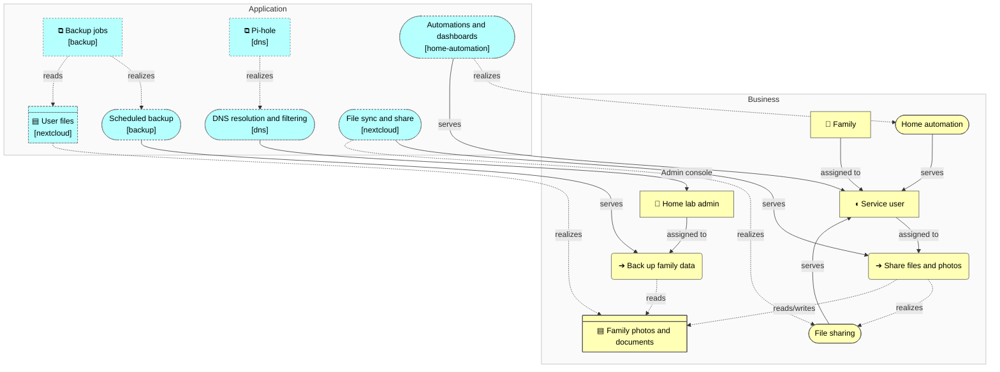
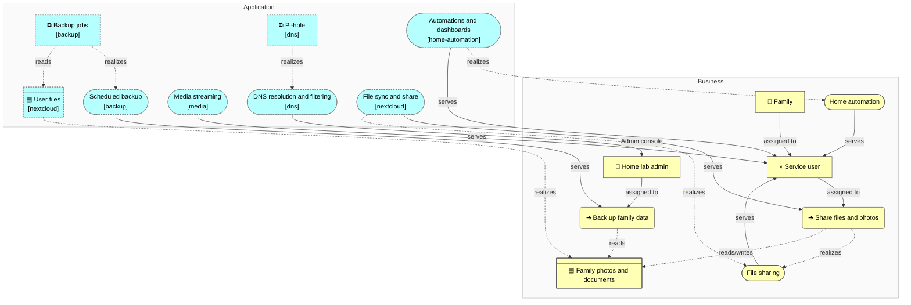

<!-- generated by a4m build; edit models/, not this file -->
# Business and supporting services

*ArchiMate view* · source `models/enterprise/views/views.yaml` · [index](README.md)

Who uses the home lab and which application services of the solution architectures support them.

```mermaid
flowchart TB
  subgraph layer_business["Business"]
    direction LR
    bus_family@{ shape: rect, label: "👤 Family" }
    bus_admin@{ shape: rect, label: "👤 Home lab admin" }
    bus_role_user@{ shape: rect, label: "◖ Service user" }
    bus_proc_share@{ shape: rounded, label: "➔ Share files and photos" }
    bus_proc_backup@{ shape: rounded, label: "➔ Back up family data" }
    bus_svc_file_sharing@{ shape: stadium, label: "File sharing" }
    bus_svc_automation@{ shape: stadium, label: "Home automation" }
    bus_obj_photos@{ shape: div-rect, label: "▤ Family photos and documents" }
  end
  subgraph layer_application["Application"]
    direction LR
    backup__app_backup@{ shape: rect, label: "⧉ Backup jobs<br/>[backup]" }
    backup__app_svc_backup@{ shape: stadium, label: "Scheduled backup<br/>[backup]" }
    dns__app_pihole@{ shape: rect, label: "⧉ Pi-hole<br/>[dns]" }
    dns__app_svc_dns@{ shape: stadium, label: "DNS resolution and filtering<br/>[dns]" }
    home_automation__app_svc_automation@{ shape: stadium, label: "Automations and dashboards<br/>[home-automation]" }
    media__app_svc_streaming@{ shape: stadium, label: "Media streaming<br/>[media]<br/>NEW" }
    nextcloud__app_data_files@{ shape: div-rect, label: "▤ User files<br/>[nextcloud]" }
    nextcloud__app_svc_file_sync@{ shape: stadium, label: "File sync and share<br/>[nextcloud]" }
  end
  bus_family -->|"assigned to"| bus_role_user
  bus_role_user -->|"assigned to"| bus_proc_share
  bus_admin -->|"assigned to"| bus_proc_backup
  bus_proc_share -.->|"realizes"| bus_svc_file_sharing
  bus_svc_file_sharing -->|"serves"| bus_role_user
  bus_svc_automation -->|"serves"| bus_role_user
  bus_proc_share -.->|"reads/writes"| bus_obj_photos
  bus_proc_backup -.->|"reads"| bus_obj_photos
  backup__app_backup -.->|"realizes"| backup__app_svc_backup
  backup__app_svc_backup -->|"serves"| bus_proc_backup
  backup__app_backup -.->|"reads"| nextcloud__app_data_files
  dns__app_pihole -.->|"realizes"| dns__app_svc_dns
  dns__app_svc_dns -->|"Admin console"| bus_admin
  home_automation__app_svc_automation -.->|"realizes"| bus_svc_automation
  home_automation__app_svc_automation -->|"serves"| bus_role_user
  media__app_svc_streaming -->|"serves"| bus_role_user
  nextcloud__app_svc_file_sync -->|"serves"| bus_proc_share
  nextcloud__app_svc_file_sync -.->|"realizes"| bus_svc_file_sharing
  nextcloud__app_data_files -.->|"realizes"| bus_obj_photos
  classDef business fill:#FFFFB5,stroke:#555,color:#000
  class bus_family,bus_admin,bus_role_user,bus_proc_share,bus_proc_backup,bus_svc_file_sharing,bus_svc_automation,bus_obj_photos business
  style layer_business fill:#fafafa,stroke:#bbb
  classDef application fill:#B5FFFF,stroke:#555,color:#000
  class backup__app_backup,backup__app_svc_backup,dns__app_pihole,dns__app_svc_dns,home_automation__app_svc_automation,media__app_svc_streaming,nextcloud__app_data_files,nextcloud__app_svc_file_sync application
  style layer_application fill:#fafafa,stroke:#bbb
  classDef foreign stroke:#777,stroke-dasharray:3 3
  class backup__app_backup,backup__app_svc_backup,dns__app_pihole,dns__app_svc_dns,home_automation__app_svc_automation,media__app_svc_streaming,nextcloud__app_data_files,nextcloud__app_svc_file_sync foreign
  classDef st_new stroke:#2e7d32,stroke-width:3px,stroke-dasharray:6 4
  class media__app_svc_streaming st_new
  linkStyle 15 stroke:#2e7d32,stroke-width:2px,stroke-dasharray:6 4
```

*Notation: 👤 Business actor · ▤ Business object · ➔ Business process · ◖ Business role · (pill) Business service · ⧉ Application component · (pill) Application service · ▤ Data object*

*Change highlighting: green = new, orange = changed, red = retiring (purple = proposed by an SA that is not approved yet).*

Current state

Target state

## Elements

| Element | Type | Layer | C4 | State | Description |
|---|---|---|---|---|---|
| Family (`bus-family`) | BusinessActor | Business | person |  | Household members using files, photos and smart-home dashboards. |
| Home lab admin (`bus-admin`) | BusinessActor | Business | person |  | Runs and maintains the home lab. |
| Service user (`bus-role-user`) | BusinessRole | Business |  |  |  |
| Share files and photos (`bus-proc-share`) | BusinessProcess | Business |  |  |  |
| Back up family data (`bus-proc-backup`) | BusinessProcess | Business |  |  |  |
| File sharing (`bus-svc-file-sharing`) | BusinessService | Business |  |  |  |
| Home automation (`bus-svc-automation`) | BusinessService | Business |  |  |  |
| Family photos and documents (`bus-obj-photos`) | BusinessObject | Business |  |  |  |
| Backup jobs (`backup/app-backup`) | ApplicationComponent | Application | system |  | Nightly restic snapshots of Nextcloud data and its database. |
| Scheduled backup (`backup/app-svc-backup`) | ApplicationService | Application |  |  |  |
| Pi-hole (`dns/app-pihole`) | ApplicationComponent | Application | system |  | Network-wide DNS resolver with ad and tracker blocking. |
| DNS resolution and filtering (`dns/app-svc-dns`) | ApplicationService | Application |  |  |  |
| Automations and dashboards (`home-automation/app-svc-automation`) | ApplicationService | Application |  |  |  |
| Media streaming (`media/app-svc-streaming`) | ApplicationService | Application |  | new |  |
| User files (`nextcloud/app-data-files`) | DataObject | Application |  |  | Family files and photos, stored on the NAS over NFS. |
| File sync and share (`nextcloud/app-svc-file-sync`) | ApplicationService | Application |  |  |  |
