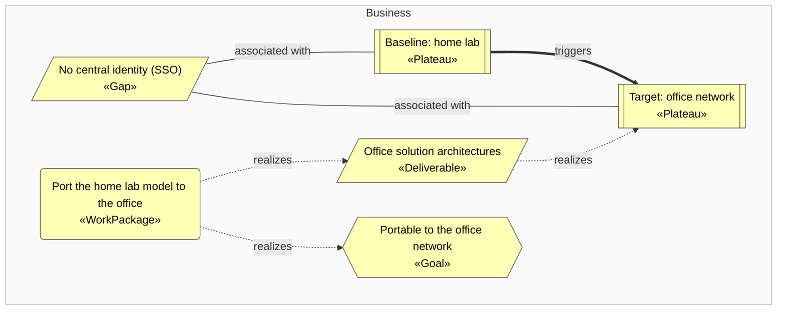

<!-- generated by a4m build; edit models/, not this file -->
# Office migration roadmap

*ArchiMate view · Implementation and Migration viewpoint* · source `models/enterprise/views/views.yaml` · [index](README.md)

## Elements

| Element | Type | Layer | C4 | State | Description |
|---|---|---|---|---|---|
| Portable to the office network (`bus-goal-portable`) | Goal | Business |  |  | The same tooling and patterns must be reusable for the office environment. |
| Baseline: home lab (`bus-plateau-homelab`) | Plateau | Business |  |  |  |
| Target: office network (`bus-plateau-office`) | Plateau | Business |  |  |  |
| No central identity (SSO) (`bus-gap-identity`) | Gap | Business |  |  |  |
| Port the home lab model to the office (`bus-wp-office`) | WorkPackage | Business |  |  | Copy the repo, model the office SAs under models/, switch the LLM assistant to GitHub Copilot. |
| Office solution architectures (`bus-del-office-model`) | Deliverable | Business |  |  |  |

## Related decisions

- [ADR-0001: Keep the architecture as ArchiMate YAML in git, with C4 as derived views](../../models/enterprise/decisions/ADR-0001-architecture-as-code-with-archimate.md) — *accepted*
