<!-- generated by a4m build; edit models/, not this file -->
# Motivation and strategy

*ArchiMate view* · source `models/enterprise/views/views.yaml` · [index](README.md)

Why the home lab exists, which capabilities it provides, and which solutions realize the requirements.

```mermaid
flowchart TB
  subgraph layer_motivation["Motivation"]
    direction LR
    mot_family{{"Family<br/>«Stakeholder»"}}
    mot_drv_privacy{{"Data privacy<br/>«Driver»"}}
    mot_asm_single_host{{"Single hypervisor is a SPOF<br/>«Assessment»"}}
    mot_goal_reliable{{"Reliable self-hosted services<br/>«Goal»"}}
    mot_goal_portable{{"Portable to the office network<br/>«Goal»"}}
    mot_pri_as_code{{"Architecture as code<br/>«Principle»"}}
    mot_req_backup{{"Nightly off-site backups<br/>«Requirement»"}}
    mot_req_dns_filter{{"Network-wide ad and tracker blocking<br/>«Requirement»"}}
  end
  subgraph layer_strategy["Strategy"]
    direction LR
    str_cap_home_it("Home IT services<br/>«Capability»")
    str_cap_file_sharing("File sharing and sync<br/>«Capability»")
    str_cap_home_automation("Home automation<br/>«Capability»")
    str_res_hardware["Home lab hardware<br/>«Resource»"]
  end
  subgraph layer_application["Application"]
    direction LR
    dns__app_pihole["Pi-hole<br/>«ApplicationComponent» · dns"]
    backup__app_backup["Backup jobs<br/>«ApplicationComponent» · backup"]
  end
  subgraph layer_technology["Technology"]
    direction LR
    compute__tech_pve_01["Proxmox host 01<br/>«Node» · compute"]
    compute__tech_nas["NAS<br/>«Device» · compute"]
  end
  mot_family ---|"associated with"| mot_drv_privacy
  mot_drv_privacy -.->|"influences +"| mot_goal_reliable
  mot_asm_single_host ---|"associated with"| mot_drv_privacy
  mot_asm_single_host -.->|"influences -"| mot_goal_reliable
  mot_pri_as_code -.->|"realizes"| mot_goal_portable
  mot_req_backup -.->|"realizes"| mot_goal_reliable
  mot_req_dns_filter -.->|"realizes"| mot_goal_reliable
  str_cap_home_it -->|"composed of"| str_cap_file_sharing
  str_cap_home_it -->|"composed of"| str_cap_home_automation
  str_cap_home_it -.->|"realizes"| mot_goal_reliable
  str_res_hardware -->|"assigned to"| str_cap_home_it
  backup__app_backup -.->|"realizes"| mot_req_backup
  compute__tech_nas -.->|"realizes"| backup__app_backup
  compute__tech_pve_01 -.->|"realizes"| str_res_hardware
  compute__tech_nas -.->|"realizes"| str_res_hardware
  dns__app_pihole -.->|"realizes"| mot_req_dns_filter
  classDef motivation fill:#CCCCFF,stroke:#555,color:#000
  class mot_family,mot_drv_privacy,mot_asm_single_host,mot_goal_reliable,mot_goal_portable,mot_pri_as_code,mot_req_backup,mot_req_dns_filter motivation
  style layer_motivation fill:#fafafa,stroke:#bbb
  classDef strategy fill:#F5DEAA,stroke:#555,color:#000
  class str_cap_home_it,str_cap_file_sharing,str_cap_home_automation,str_res_hardware strategy
  style layer_strategy fill:#fafafa,stroke:#bbb
  classDef application fill:#B5FFFF,stroke:#555,color:#000
  class dns__app_pihole,backup__app_backup application
  style layer_application fill:#fafafa,stroke:#bbb
  classDef technology fill:#C9E7B7,stroke:#555,color:#000
  class compute__tech_pve_01,compute__tech_nas technology
  style layer_technology fill:#fafafa,stroke:#bbb
  classDef foreign stroke:#777,stroke-dasharray:3 3
  class dns__app_pihole,backup__app_backup,compute__tech_pve_01,compute__tech_nas foreign
```

## Elements

| Element | Type | Layer | C4 | State | Description |
|---|---|---|---|---|---|
| Pi-hole (`dns/app-pihole`) | ApplicationComponent | Application | system |  | Network-wide DNS resolver with ad and tracker blocking. |
| Backup jobs (`backup/app-backup`) | ApplicationComponent | Application | system |  | Nightly restic snapshots of Nextcloud data and its database. |
| Proxmox host 01 (`compute/tech-pve-01`) | Node | Technology | deployment |  | Mini PC hypervisor; the only compute host (see enterprise/mot-asm-single-host). |
| NAS (`compute/tech-nas`) | Device | Technology | deployment |  | Synology NAS holding solution data (NFS) and running backup jobs. |
| Family (`mot-family`) | Stakeholder | Motivation |  |  | Everyone in the household who relies on the self-hosted services. |
| Data privacy (`mot-drv-privacy`) | Driver | Motivation |  |  | Keep family photos, documents and smart-home data off third-party clouds. |
| Single hypervisor is a SPOF (`mot-asm-single-host`) | Assessment | Motivation |  |  | All VMs run on one Proxmox host; a hardware failure takes every service down. |
| Reliable self-hosted services (`mot-goal-reliable`) | Goal | Motivation |  |  |  |
| Portable to the office network (`mot-goal-portable`) | Goal | Motivation |  |  | The same tooling and patterns must be reusable for the office environment. |
| Architecture as code (`mot-pri-as-code`) | Principle | Motivation |  |  | The architecture lives in git as validated ArchiMate YAML; diagrams are generated. |
| Nightly off-site backups (`mot-req-backup`) | Requirement | Motivation |  |  |  |
| Network-wide ad and tracker blocking (`mot-req-dns-filter`) | Requirement | Motivation |  |  |  |
| Home IT services (`str-cap-home-it`) | Capability | Strategy |  |  |  |
| File sharing and sync (`str-cap-file-sharing`) | Capability | Strategy |  |  |  |
| Home automation (`str-cap-home-automation`) | Capability | Strategy |  |  |  |
| Home lab hardware (`str-res-hardware`) | Resource | Strategy |  |  | Hypervisor, NAS, network gear and UPS (see the compute and network SAs). |

## Related decisions

- [ADR-0001: Keep the architecture as ArchiMate YAML in git, with C4 as derived views](../../models/enterprise/decisions/ADR-0001-architecture-as-code-with-archimate.md) — *accepted*
