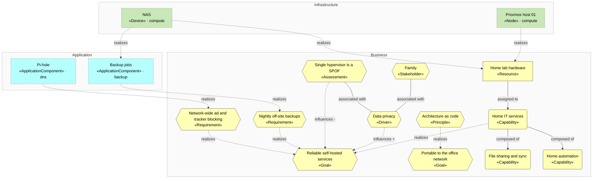

<!-- generated by a4m build; edit models/, not this file -->
# Motivation and strategy

*ArchiMate view* · source `models/enterprise/views/views.yaml` · [index](README.md)

Why the home lab exists, which capabilities it provides, and which solutions realize the requirements.

## Elements

| Element | Type | Layer | C4 | State | Description |
|---|---|---|---|---|---|
| Family (`bus-stk-family`) | Stakeholder | Business |  |  | Everyone in the household who relies on the self-hosted services. |
| Data privacy (`bus-drv-privacy`) | Driver | Business |  |  | Keep family photos, documents and smart-home data off third-party clouds. |
| Single hypervisor is a SPOF (`bus-asm-single-host`) | Assessment | Business |  |  | All VMs run on one Proxmox host; a hardware failure takes every service down. |
| Reliable self-hosted services (`bus-goal-reliable`) | Goal | Business |  |  |  |
| Portable to the office network (`bus-goal-portable`) | Goal | Business |  |  | The same tooling and patterns must be reusable for the office environment. |
| Architecture as code (`bus-pri-as-code`) | Principle | Business |  |  | The architecture lives in git as validated ArchiMate YAML; diagrams are generated. |
| Nightly off-site backups (`bus-req-backup`) | Requirement | Business |  |  |  |
| Network-wide ad and tracker blocking (`bus-req-dns-filter`) | Requirement | Business |  |  |  |
| Home IT services (`bus-cap-home-it`) | Capability | Business |  |  |  |
| File sharing and sync (`bus-cap-file-sharing`) | Capability | Business |  |  |  |
| Home automation (`bus-cap-home-automation`) | Capability | Business |  |  |  |
| Home lab hardware (`bus-res-hardware`) | Resource | Business |  |  | Hypervisor, NAS, network gear and UPS (see the compute and network SAs). |
| Pi-hole (`dns/app-pihole`) | ApplicationComponent | Application | system |  | Network-wide DNS resolver with ad and tracker blocking. |
| Backup jobs (`backup/app-backup`) | ApplicationComponent | Application | system |  | Nightly restic snapshots of Nextcloud data and its database. |
| Proxmox host 01 (`compute/infra-pve-01`) | Node | Infrastructure | deployment |  | Mini PC hypervisor; the only compute host (see enterprise/bus-asm-single-host). |
| NAS (`compute/infra-nas`) | Device | Infrastructure | deployment |  | Synology NAS holding solution data (NFS) and running backup jobs. |

## Related decisions

- [ADR-0001: Keep the architecture as ArchiMate YAML in git, with C4 as derived views](../../models/enterprise/decisions/ADR-0001-architecture-as-code-with-archimate.md) — *accepted*
