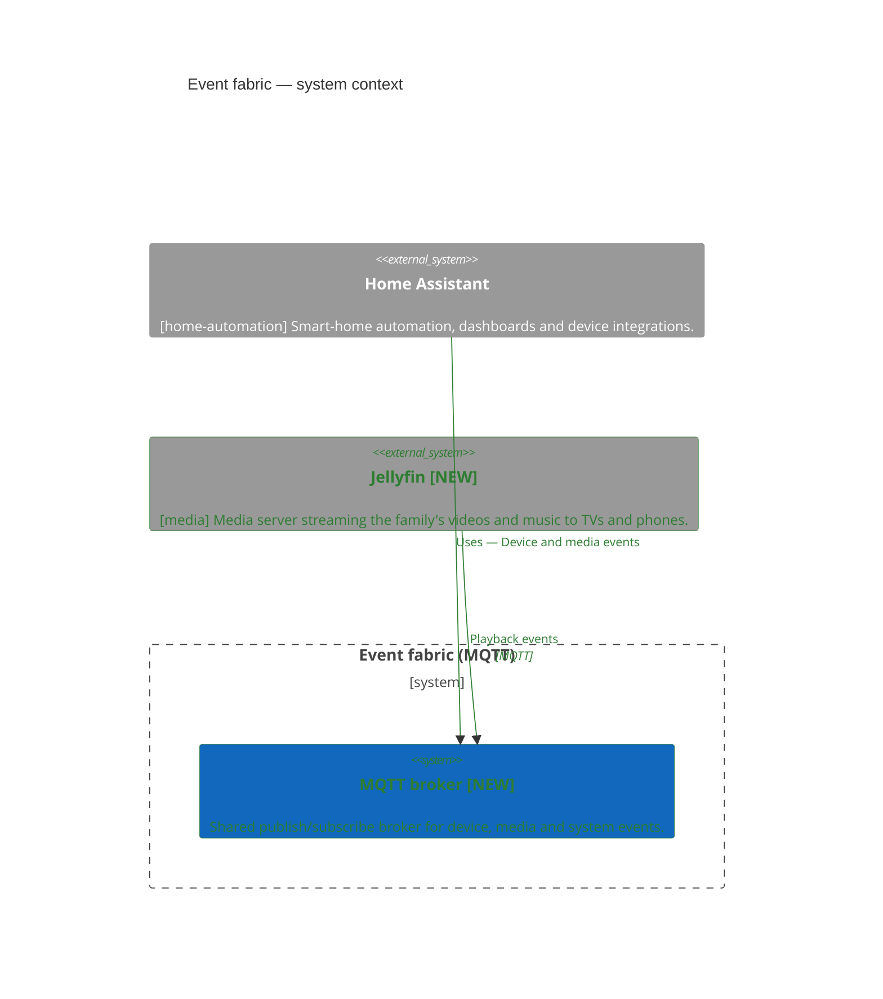
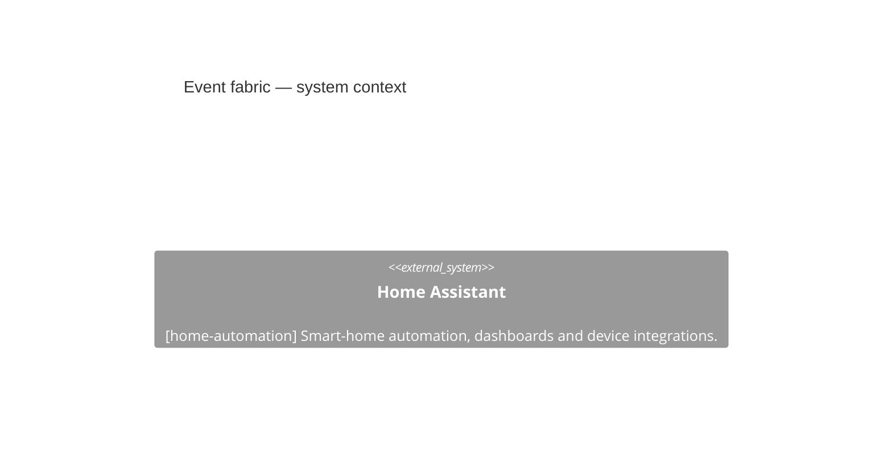
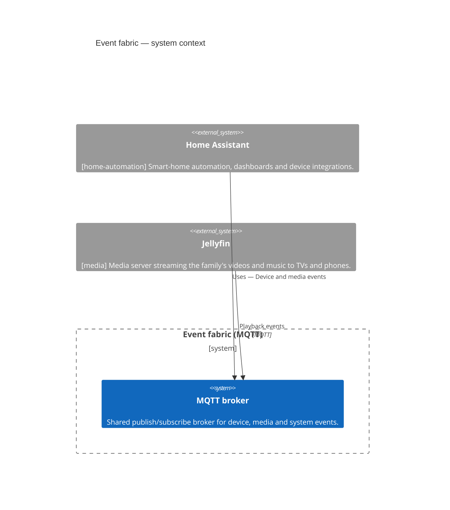

<!-- generated by a4m build; edit models/, not this file -->
# Event fabric — system context

*C4 context view* · source `models/events/views/views.yaml` · [index](README.md)

*Change highlighting: green = new, orange = changed, red = retiring (purple = proposed by an SA that is not approved yet).*

Current state

Target state

## Elements

| Element | Type | Layer | C4 | State | Description |
|---|---|---|---|---|---|
| MQTT broker (`app-mqtt-broker`) | ApplicationComponent | Application | system | new | Shared publish/subscribe broker for device, media and system events. |
| Home Assistant (`home-automation/app-home-assistant`) | ApplicationComponent | Application | system |  | Smart-home automation, dashboards and device integrations. |
| Jellyfin (`media/app-jellyfin`) | ApplicationComponent | Application | system | new | Media server streaming the family's videos and music to TVs and phones. |

## Related decisions

- [ADR-0001: Introduce a shared MQTT event fabric](../../models/events/decisions/ADR-0001-introduce-a-shared-mqtt-event-fabric.md) — *proposed*
