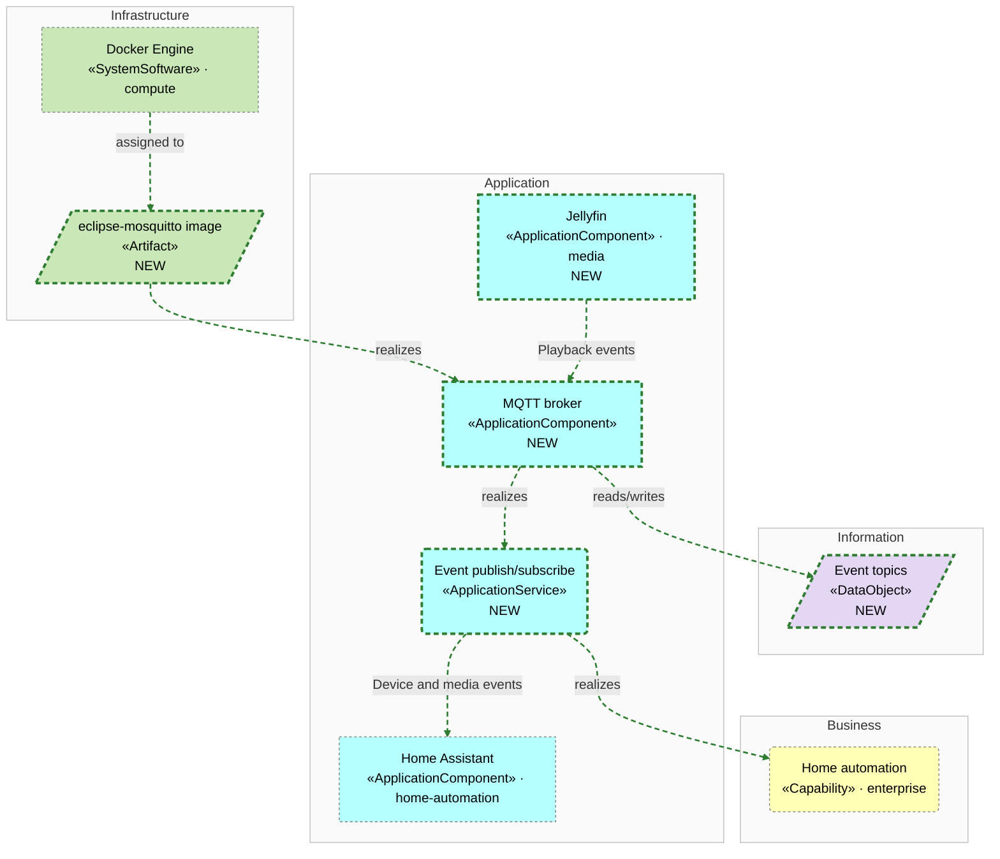
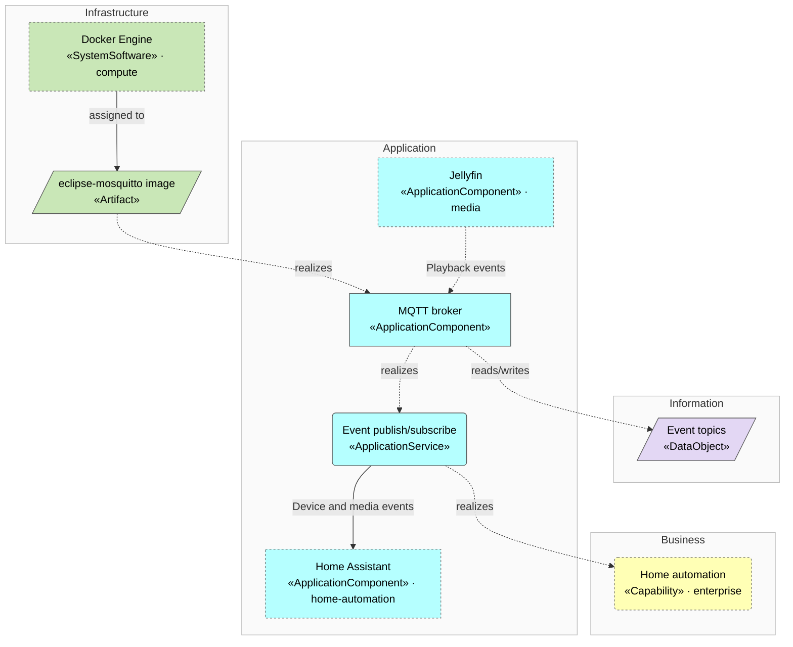

<!-- generated by a4m build; edit models/, not this file -->
# Event fabric — overview

*ArchiMate view · Layered viewpoint* · source `models/events/views/views.yaml` · [index](README.md)



*Change highlighting: green = new, orange = changed, red = retiring (purple = proposed by an SA that is not approved yet).*

<details><summary>Current state</summary>

```mermaid
flowchart TB
```

</details>

<details><summary>Target state</summary>



</details>

## Elements

| Element | Type | Layer | C4 | State | Description |
|---|---|---|---|---|---|
| MQTT broker (`app-mqtt-broker`) | ApplicationComponent | Application | system | new | Shared publish/subscribe broker for device, media and system events. |
| Event publish/subscribe (`app-svc-event-streaming`) | ApplicationService | Application |  | new | Topics under home/<source>/<event>, TLS on port 8883, one account per client. |
| Event topics (`data-events`) | DataObject | Information |  | new | Retained state and event messages, kept by the broker until consumed. |
| eclipse-mosquitto image (`infra-art-mosquitto`) | Artifact | Infrastructure |  | new |  |
| Docker Engine (`compute/infra-docker`) | SystemSoftware | Infrastructure | deployment |  |  |
| Home automation (`enterprise/bus-cap-home-automation`) | Capability | Business |  |  |  |
| Home Assistant (`home-automation/app-home-assistant`) | ApplicationComponent | Application | system |  | Smart-home automation, dashboards and device integrations. |
| Jellyfin (`media/app-jellyfin`) | ApplicationComponent | Application | system | new | Media server streaming the family's videos and music to TVs and phones. |

## Related decisions

- [ADR-0001: Introduce a shared MQTT event fabric](../../models/events/decisions/ADR-0001-introduce-a-shared-mqtt-event-fabric.md) — *proposed*
