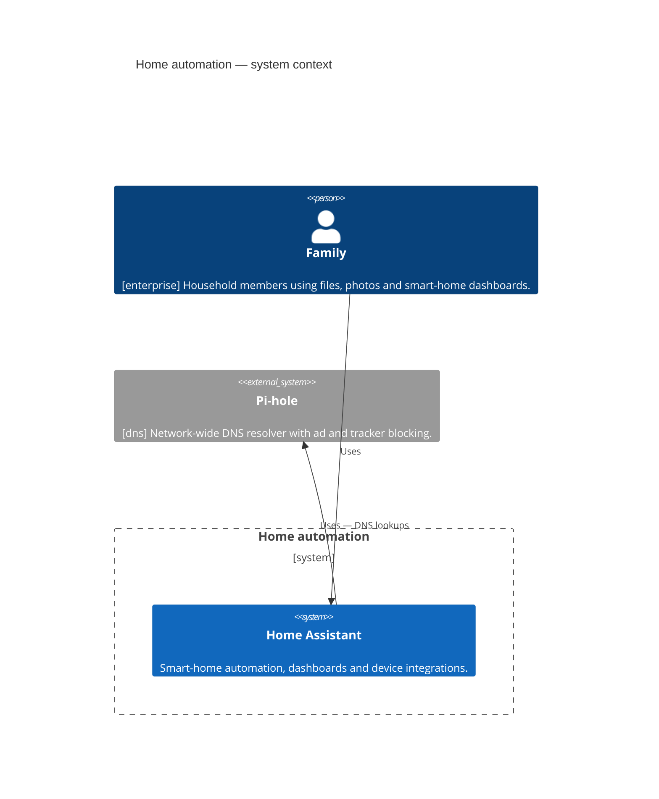
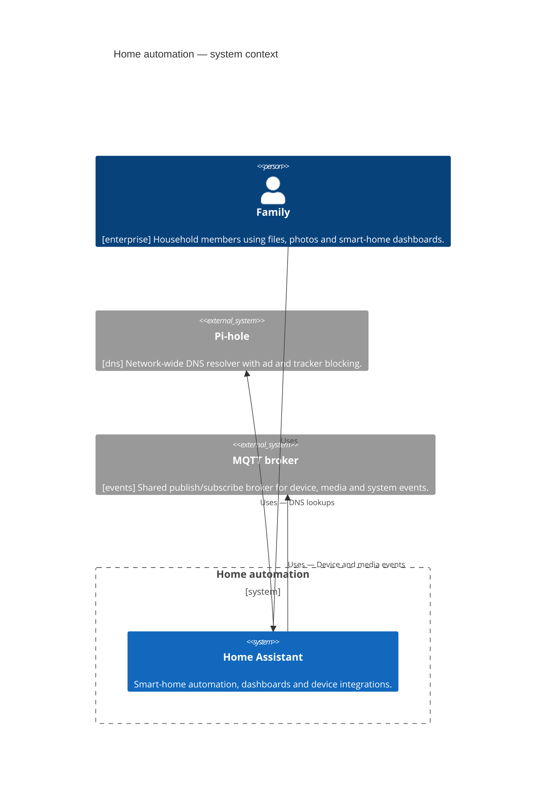

<!-- generated by a4m build; edit models/, not this file -->
# Home automation — system context

*C4 context view* · source `models/home-automation/views/views.yaml` · [index](README.md)

*Change highlighting: green = new, orange = changed, red = retiring (purple = proposed by an SA that is not approved yet).*

Current state

Target state

## Elements

| Element | Type | Layer | C4 | State | Description |
|---|---|---|---|---|---|
| Family (`enterprise/bus-family`) | BusinessActor | Business | person |  | Household members using files, photos and smart-home dashboards. |
| Home Assistant (`app-home-assistant`) | ApplicationComponent | Application | system |  | Smart-home automation, dashboards and device integrations. |
| Pi-hole (`dns/app-pihole`) | ApplicationComponent | Application | system |  | Network-wide DNS resolver with ad and tracker blocking. |
| MQTT broker (`events/app-mqtt-broker`) | ApplicationComponent | Application | system | new | Shared publish/subscribe broker for device, media and system events. |
