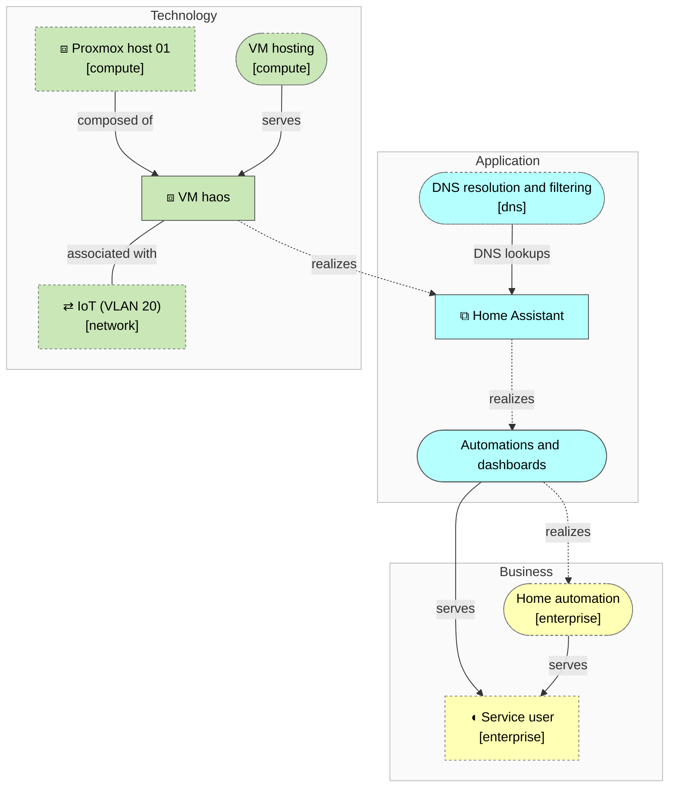

<!-- generated by a4m build; edit models/, not this file -->
# Home automation — overview

*ArchiMate view · Layered viewpoint* · source `models/home-automation/views/views.yaml` · [index](README.md)

*Notation: ◖ Business role · (pill) Business service · ⧉ Application component · (pill) Application service · ⇄ Communication network · ⧈ Node · (pill) Technology service*

## Elements

| Element | Type | Layer | C4 | State | Description |
|---|---|---|---|---|---|
| Home Assistant (`app-home-assistant`) | ApplicationComponent | Application | system |  | Smart-home automation, dashboards and device integrations. |
| Automations and dashboards (`app-svc-automation`) | ApplicationService | Application |  |  |  |
| VM haos (`tech-vm-haos`) | Node | Technology | deployment |  |  |
| Proxmox host 01 (`compute/tech-pve-01`) | Node | Technology | deployment |  | Mini PC hypervisor; the only compute host (see enterprise/mot-asm-single-host). |
| VM hosting (`compute/tech-svc-vm-hosting`) | TechnologyService | Technology |  |  |  |
| DNS resolution and filtering (`dns/app-svc-dns`) | ApplicationService | Application |  |  |  |
| Service user (`enterprise/bus-role-user`) | BusinessRole | Business |  |  |  |
| Home automation (`enterprise/bus-svc-automation`) | BusinessService | Business |  |  |  |
| IoT (VLAN 20) (`network/tech-net-iot`) | CommunicationNetwork | Technology |  |  |  |
