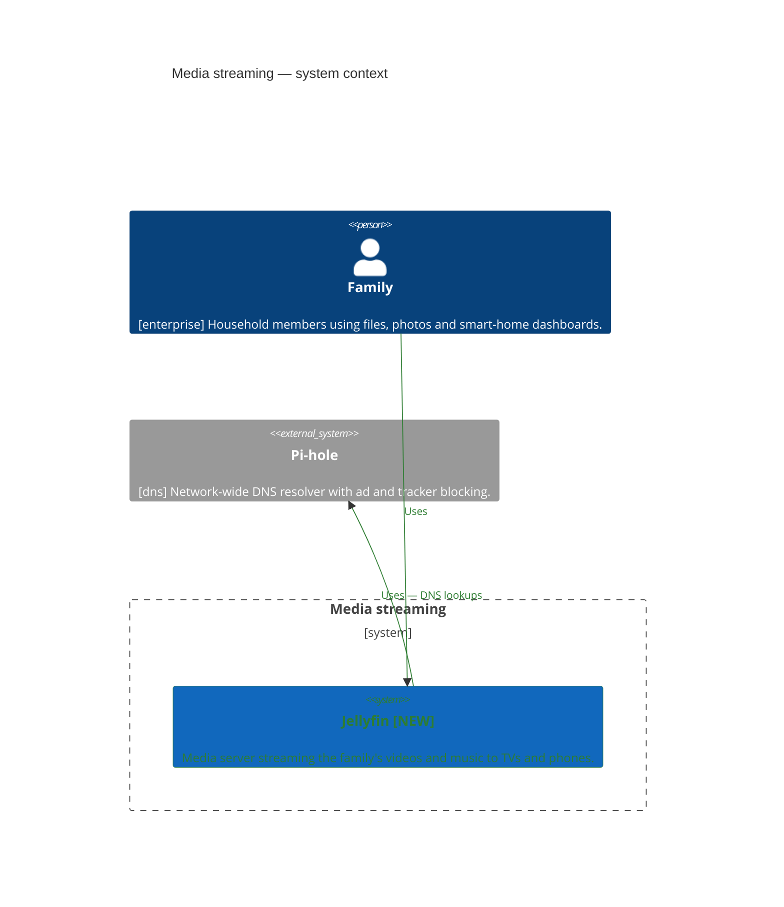
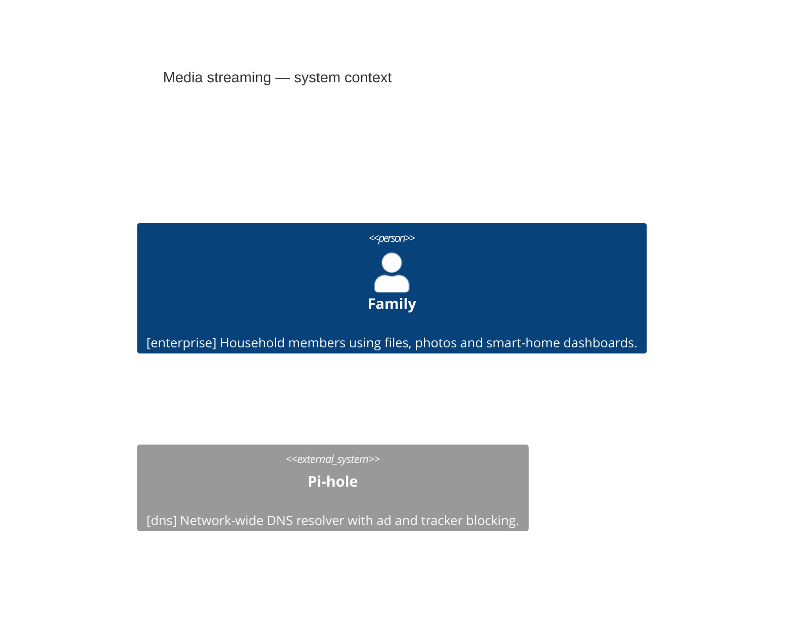

<!-- generated by a4m build; edit models/, not this file -->
# Media streaming — system context

*C4 context view* · source `models/media/views/views.yaml` · [index](README.md)

*Change highlighting: green = new, orange = changed, red = retiring (purple = proposed by an SA that is not approved yet).*

Current state

Target state

## Elements

| Element | Type | Layer | C4 | State | Description |
|---|---|---|---|---|---|
| Family (`enterprise/bus-family`) | BusinessActor | Business | person |  | Household members using files, photos and smart-home dashboards. |
| Jellyfin (`app-jellyfin`) | ApplicationComponent | Application | system | new | Media server streaming the family's videos and music to TVs and phones. |
| Pi-hole (`dns/app-pihole`) | ApplicationComponent | Application | system |  | Network-wide DNS resolver with ad and tracker blocking. |

## Related decisions

- [ADR-0001: Add Jellyfin as the family media server](../../models/media/decisions/ADR-0001-add-jellyfin-media-server.md) — *proposed*
