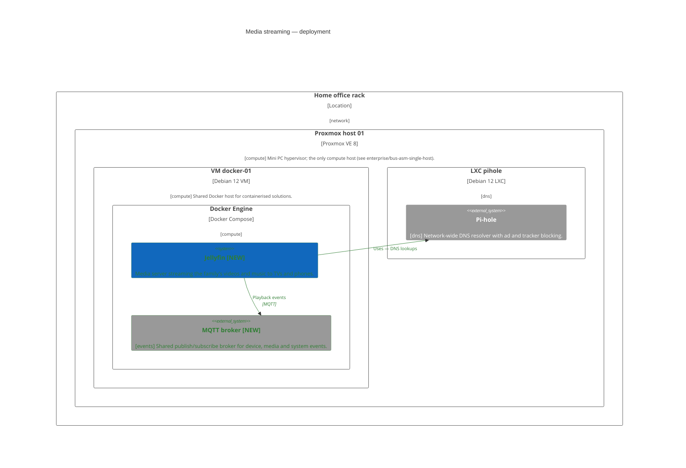

<!-- generated by a4m build; edit models/, not this file -->
# Media streaming — deployment

*C4 deployment view* · source `models/media/views/views.yaml` · [index](README.md)



*Change highlighting: green = new, orange = changed, red = retiring (purple = proposed by an SA that is not approved yet).*

<details><summary>Current state</summary>

```mermaid
C4Deployment
  title Media streaming — deployment
  UpdateLayoutConfig($c4ShapeInRow="4", $c4BoundaryInRow="2")
```

</details>

<details><summary>Target state</summary>


</details>

## Elements

| Element | Type | Layer | C4 | State | Description |
|---|---|---|---|---|---|
| Jellyfin (`app-jellyfin`) | ApplicationComponent | Application | system | new | Media server streaming the family's videos and music to TVs and phones. |
| Pi-hole (`dns/app-pihole`) | ApplicationComponent | Application | system |  | Network-wide DNS resolver with ad and tracker blocking. |
| MQTT broker (`events/app-mqtt-broker`) | ApplicationComponent | Application | system | new | Shared publish/subscribe broker for device, media and system events. |
| Home office rack (`network/infra-loc-home`) | Location | Infrastructure | deployment |  |  |
| Proxmox host 01 (`compute/infra-pve-01`) | Node | Infrastructure | deployment |  | Mini PC hypervisor; the only compute host (see enterprise/bus-asm-single-host). |
| VM docker-01 (`compute/infra-vm-docker`) | Node | Infrastructure | deployment |  | Shared Docker host for containerised solutions. |
| Docker Engine (`compute/infra-docker`) | SystemSoftware | Infrastructure | deployment |  |  |
| LXC pihole (`dns/infra-lxc-pihole`) | Node | Infrastructure | deployment |  |  |

## Related decisions

- [ADR-0001: Add Jellyfin as the family media server](../../models/media/decisions/ADR-0001-add-jellyfin-media-server.md) — *proposed*
