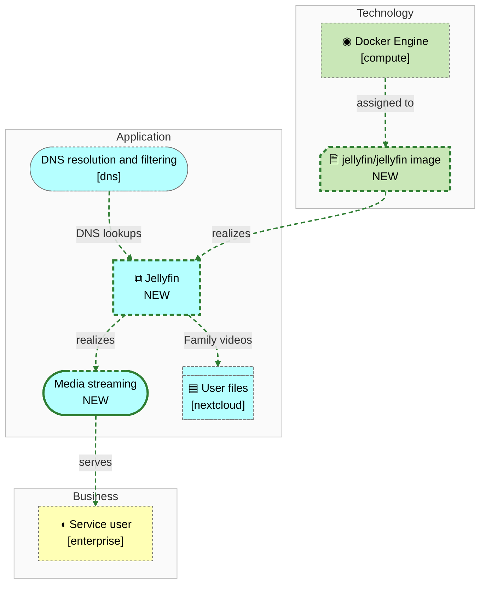
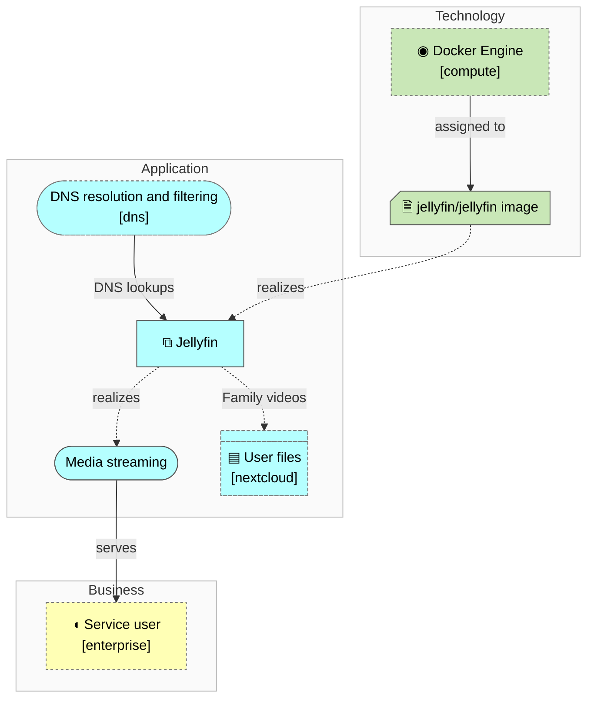

<!-- generated by a4m build; edit models/, not this file -->
# Media streaming — overview

*ArchiMate view · Layered viewpoint* · source `models/media/views/views.yaml` · [index](README.md)



*Notation: ◖ Business role · ⧉ Application component · (pill) Application service · ▤ Data object · 🗎 Artifact · ◉ System software*

*Change highlighting: green = new, orange = changed, red = retiring (purple = proposed by an SA that is not approved yet).*

<details><summary>Current state</summary>

```mermaid
flowchart TB
```

</details>

<details><summary>Target state</summary>



</details>

## Elements

| Element | Type | Layer | C4 | State | Description |
|---|---|---|---|---|---|
| Jellyfin (`app-jellyfin`) | ApplicationComponent | Application | system | new | Media server streaming the family's videos and music to TVs and phones. |
| Media streaming (`app-svc-streaming`) | ApplicationService | Application |  | new |  |
| jellyfin/jellyfin image (`tech-art-jellyfin`) | Artifact | Technology |  | new |  |
| Docker Engine (`compute/tech-docker`) | SystemSoftware | Technology | deployment |  |  |
| DNS resolution and filtering (`dns/app-svc-dns`) | ApplicationService | Application |  |  |  |
| Service user (`enterprise/bus-role-user`) | BusinessRole | Business |  |  |  |
| User files (`nextcloud/app-data-files`) | DataObject | Application |  |  | Family files and photos, stored on the NAS over NFS. |

## Related decisions

- [ADR-0001: Add Jellyfin as the family media server](../../models/media/decisions/ADR-0001-add-jellyfin-media-server.md) — *proposed*
