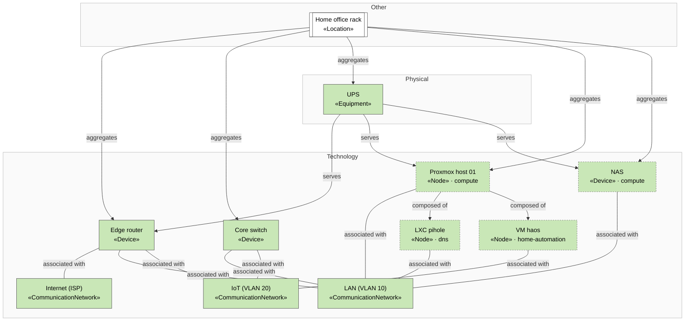

<!-- generated by a4m build; edit models/, not this file -->
# Network, rack and power

*ArchiMate view* · source `models/network/views/views.yaml` · [index](README.md)

Network segments, rack and power, with the nodes other SAs connect to them.

## Elements

| Element | Type | Layer | C4 | State | Description |
|---|---|---|---|---|---|
| Home office rack (`oth-loc-home`) | Location | Other | deployment |  |  |
| UPS (`phys-ups`) | Equipment | Physical |  |  | 900 VA line-interactive UPS; ~20 minutes runtime for host, NAS and network. |
| Edge router (`tech-router`) | Device | Technology |  |  |  |
| Core switch (`tech-switch`) | Device | Technology |  |  |  |
| Internet (ISP) (`tech-net-wan`) | CommunicationNetwork | Technology |  |  |  |
| LAN (VLAN 10) (`tech-net-lan`) | CommunicationNetwork | Technology |  |  |  |
| IoT (VLAN 20) (`tech-net-iot`) | CommunicationNetwork | Technology |  |  |  |
| NAS (`compute/tech-nas`) | Device | Technology | deployment |  | Synology NAS holding solution data (NFS) and running backup jobs. |
| Proxmox host 01 (`compute/tech-pve-01`) | Node | Technology | deployment |  | Mini PC hypervisor; the only compute host (see enterprise/mot-asm-single-host). |
| LXC pihole (`dns/tech-lxc-pihole`) | Node | Technology | deployment |  |  |
| VM haos (`home-automation/tech-vm-haos`) | Node | Technology | deployment |  |  |
