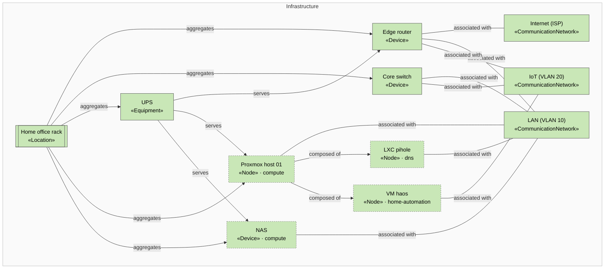

<!-- generated by a4m build; edit models/, not this file -->
# Network, rack and power

*ArchiMate view* · source `models/network/views/views.yaml` · [index](README.md)

Network segments, rack and power, with the nodes other SAs connect to them.

## Elements

| Element | Type | Layer | C4 | State | Description |
|---|---|---|---|---|---|
| Home office rack (`infra-loc-home`) | Location | Infrastructure | deployment |  |  |
| Edge router (`infra-router`) | Device | Infrastructure |  |  |  |
| Core switch (`infra-switch`) | Device | Infrastructure |  |  |  |
| Internet (ISP) (`infra-net-wan`) | CommunicationNetwork | Infrastructure |  |  |  |
| LAN (VLAN 10) (`infra-net-lan`) | CommunicationNetwork | Infrastructure |  |  |  |
| IoT (VLAN 20) (`infra-net-iot`) | CommunicationNetwork | Infrastructure |  |  |  |
| UPS (`infra-ups`) | Equipment | Infrastructure |  |  | 900 VA line-interactive UPS; ~20 minutes runtime for host, NAS and network. |
| NAS (`compute/infra-nas`) | Device | Infrastructure | deployment |  | Synology NAS holding solution data (NFS) and running backup jobs. |
| Proxmox host 01 (`compute/infra-pve-01`) | Node | Infrastructure | deployment |  | Mini PC hypervisor; the only compute host (see enterprise/bus-asm-single-host). |
| LXC pihole (`dns/infra-lxc-pihole`) | Node | Infrastructure | deployment |  |  |
| VM haos (`home-automation/infra-vm-haos`) | Node | Infrastructure | deployment |  |  |
