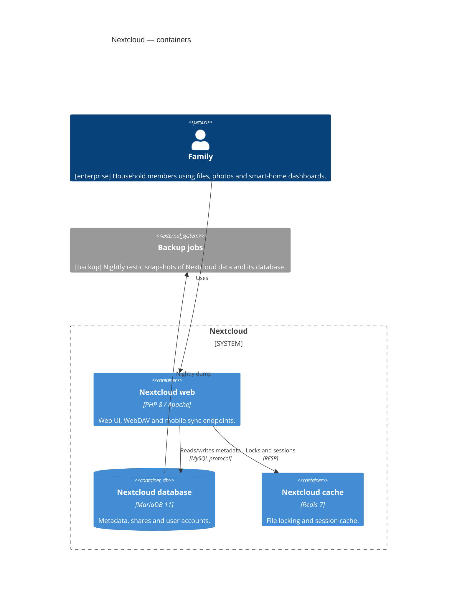

<!-- generated by a4m build; edit models/, not this file -->
# Nextcloud — containers

*C4 container view* · source `models/nextcloud/views/views.yaml` · [index](README.md)

## Elements

| Element | Type | Layer | C4 | State | Description |
|---|---|---|---|---|---|
| Nextcloud (`app-nextcloud`) | ApplicationComponent | Application | system |  | Self-hosted file sync, sharing and photo backup for the family. |
| Family (`enterprise/bus-family`) | BusinessActor | Business | person |  | Household members using files, photos and smart-home dashboards. |
| Backup jobs (`backup/app-backup`) | ApplicationComponent | Application | system |  | Nightly restic snapshots of Nextcloud data and its database. |
| Nextcloud web (`app-nextcloud-web`) | ApplicationComponent | Application | container |  | Web UI, WebDAV and mobile sync endpoints. |
| Nextcloud database (`app-nextcloud-db`) | ApplicationComponent | Application | container |  | Metadata, shares and user accounts. |
| Nextcloud cache (`app-nextcloud-cache`) | ApplicationComponent | Application | container |  | File locking and session cache. |

## Related decisions

- [ADR-0001: Run Nextcloud as Docker containers on a dedicated VM](../../models/nextcloud/decisions/ADR-0001-run-nextcloud-as-containers.md) — *accepted*
