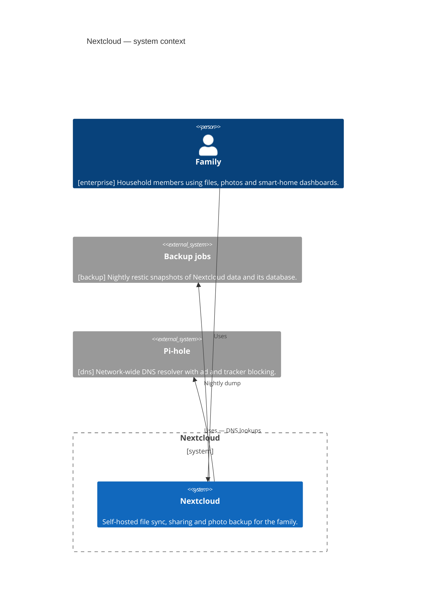

<!-- generated by a4m build; edit models/, not this file -->
# Nextcloud — system context

*C4 context view* · source `models/nextcloud/views/views.yaml` · [index](README.md)

## Elements

| Element | Type | Layer | C4 | State | Description |
|---|---|---|---|---|---|
| Family (`enterprise/bus-family`) | BusinessActor | Business | person |  | Household members using files, photos and smart-home dashboards. |
| Nextcloud (`app-nextcloud`) | ApplicationComponent | Application | system |  | Self-hosted file sync, sharing and photo backup for the family. |
| Backup jobs (`backup/app-backup`) | ApplicationComponent | Application | system |  | Nightly restic snapshots of Nextcloud data and its database. |
| Pi-hole (`dns/app-pihole`) | ApplicationComponent | Application | system |  | Network-wide DNS resolver with ad and tracker blocking. |

## Related decisions

- [ADR-0001: Run Nextcloud as Docker containers on a dedicated VM](../../models/nextcloud/decisions/ADR-0001-run-nextcloud-as-containers.md) — *accepted*
