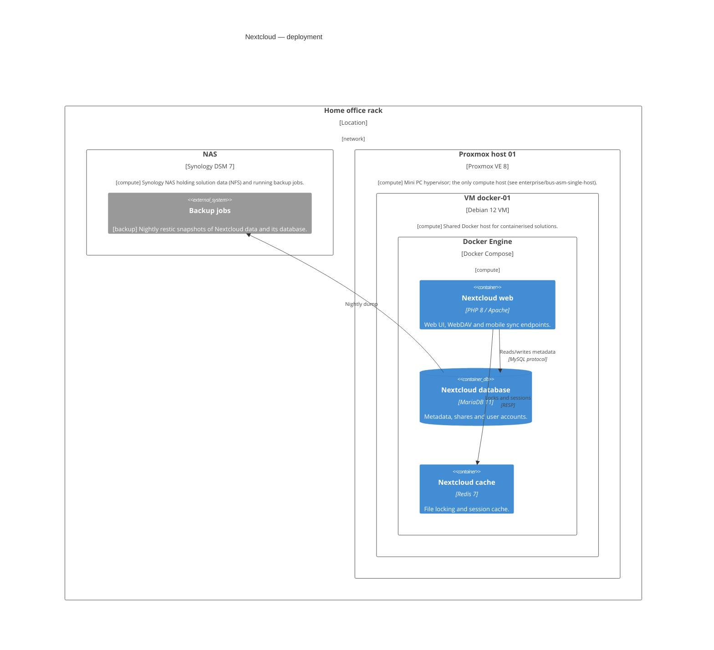

<!-- generated by a4m build; edit models/, not this file -->
# Nextcloud — deployment

*C4 deployment view* · source `models/nextcloud/views/views.yaml` · [index](README.md)

## Elements

| Element | Type | Layer | C4 | State | Description |
|---|---|---|---|---|---|
| Backup jobs (`backup/app-backup`) | ApplicationComponent | Application | system |  | Nightly restic snapshots of Nextcloud data and its database. |
| Nextcloud web (`app-nextcloud-web`) | ApplicationComponent | Application | container |  | Web UI, WebDAV and mobile sync endpoints. |
| Nextcloud database (`app-nextcloud-db`) | ApplicationComponent | Application | container |  | Metadata, shares and user accounts. |
| Nextcloud cache (`app-nextcloud-cache`) | ApplicationComponent | Application | container |  | File locking and session cache. |
| Home office rack (`network/infra-loc-home`) | Location | Infrastructure | deployment |  |  |
| NAS (`compute/infra-nas`) | Device | Infrastructure | deployment |  | Synology NAS holding solution data (NFS) and running backup jobs. |
| Proxmox host 01 (`compute/infra-pve-01`) | Node | Infrastructure | deployment |  | Mini PC hypervisor; the only compute host (see enterprise/bus-asm-single-host). |
| VM docker-01 (`compute/infra-vm-docker`) | Node | Infrastructure | deployment |  | Shared Docker host for containerised solutions. |
| Docker Engine (`compute/infra-docker`) | SystemSoftware | Infrastructure | deployment |  |  |

## Related decisions

- [ADR-0001: Run Nextcloud as Docker containers on a dedicated VM](../../models/nextcloud/decisions/ADR-0001-run-nextcloud-as-containers.md) — *accepted*
