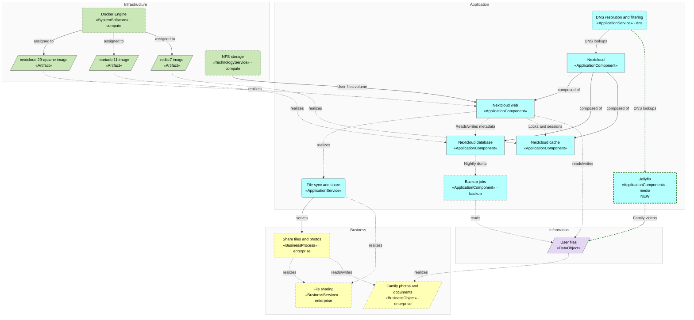
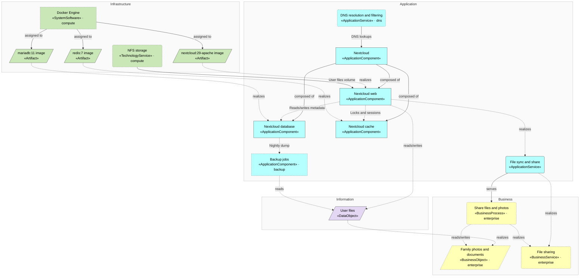
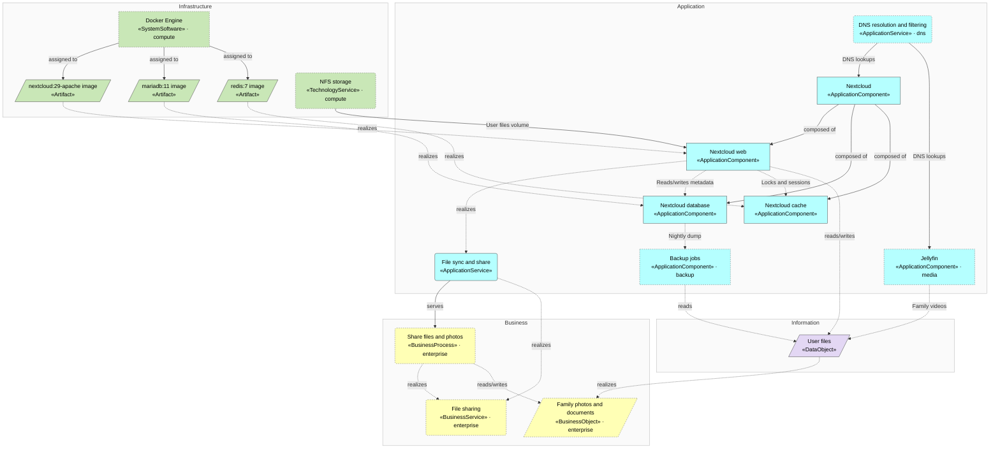

<!-- generated by a4m build; edit models/, not this file -->
# Nextcloud — layered overview

*ArchiMate view · Layered viewpoint* · source `models/nextcloud/views/views.yaml` · [index](README.md)

The business it supports, the application, and the platform it runs on.

*Change highlighting: green = new, orange = changed, red = retiring (purple = proposed by an SA that is not approved yet).*

Current state

Target state

## Elements

| Element | Type | Layer | C4 | State | Description |
|---|---|---|---|---|---|
| Nextcloud (`app-nextcloud`) | ApplicationComponent | Application | system |  | Self-hosted file sync, sharing and photo backup for the family. |
| Nextcloud web (`app-nextcloud-web`) | ApplicationComponent | Application | container |  | Web UI, WebDAV and mobile sync endpoints. |
| Nextcloud database (`app-nextcloud-db`) | ApplicationComponent | Application | container |  | Metadata, shares and user accounts. |
| Nextcloud cache (`app-nextcloud-cache`) | ApplicationComponent | Application | container |  | File locking and session cache. |
| File sync and share (`app-svc-file-sync`) | ApplicationService | Application |  |  |  |
| User files (`data-files`) | DataObject | Information |  |  | Family files and photos, stored on the NAS over NFS. |
| nextcloud:29-apache image (`infra-art-nextcloud`) | Artifact | Infrastructure |  |  |  |
| mariadb:11 image (`infra-art-mariadb`) | Artifact | Infrastructure |  |  |  |
| redis:7 image (`infra-art-redis`) | Artifact | Infrastructure |  |  |  |
| Backup jobs (`backup/app-backup`) | ApplicationComponent | Application | system |  | Nightly restic snapshots of Nextcloud data and its database. |
| Docker Engine (`compute/infra-docker`) | SystemSoftware | Infrastructure | deployment |  |  |
| NFS storage (`compute/infra-svc-nfs`) | TechnologyService | Infrastructure |  |  |  |
| DNS resolution and filtering (`dns/app-svc-dns`) | ApplicationService | Application |  |  |  |
| Family photos and documents (`enterprise/bus-obj-photos`) | BusinessObject | Business |  |  |  |
| Share files and photos (`enterprise/bus-proc-share`) | BusinessProcess | Business |  |  |  |
| File sharing (`enterprise/bus-svc-file-sharing`) | BusinessService | Business |  |  |  |
| Jellyfin (`media/app-jellyfin`) | ApplicationComponent | Application | system | new | Media server streaming the family's videos and music to TVs and phones. |

## Related decisions

- [ADR-0001: Run Nextcloud as Docker containers on a dedicated VM](../../models/nextcloud/decisions/ADR-0001-run-nextcloud-as-containers.md) — *accepted*
